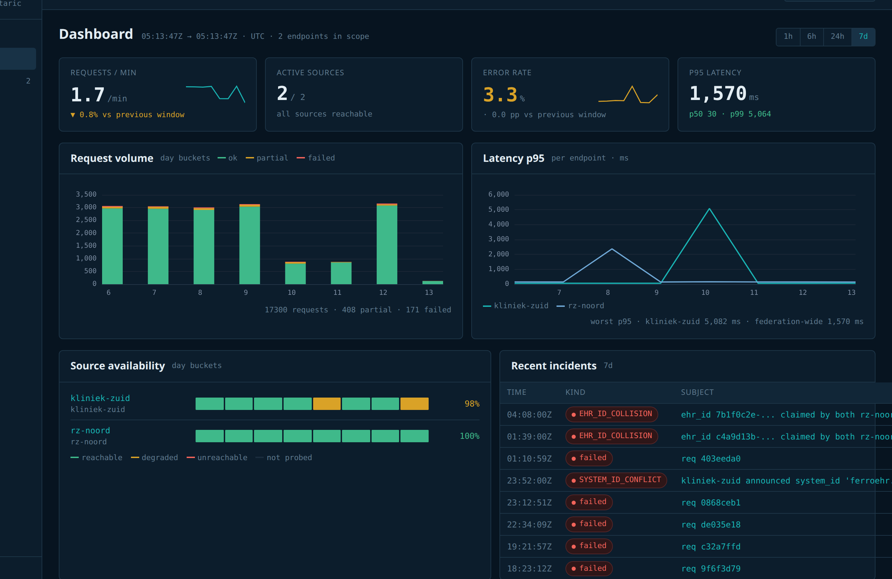

## The News

Two things this week. The openEHR SEC approved version 1.0.0 of the _Federation Tier with AQL_ specification at its
meeting on 12 October, and we're releasing **Unio**, the federation gateway we've been building alongside it.

If you missed the [earlier post](/posts/openehr-federation-spec), the short version: the spec describes how one AQL
query can run across several openEHR CDRs as if they were a single repository, while the data stays where it is. The
patient is resolved outside of AQL, each CDR gets plain AQL scoped to its own local `ehr_id`, and the gateway merges
what comes back.

> Spec: https://syntaric.github.io/openehr-federation-spec/
>
> Reference implementation: https://github.com/syntaric/openehr-federation-ref
>
> Unio: https://unio.syntaric.com

## What Changed Since the Draft

The public comment period and the SEC review brought a few changes, mostly in how the gateway behaves when something
goes wrong.

The biggest one is the default for a CDR that doesn't answer. In the draft, the gateway returned whatever it got and
flagged the rest as missing. In 1.0 the query fails by default, and a client that is fine with a partial answer has to
ask for one explicitly. That is a reversal of what the draft said, and the reasoning is simple: if a client gets an
incomplete answer about a patient, it should be because it asked for one.

Smaller changes:

- **stored queries** - a query can be registered on the gateway once and called by name, the same way as on a regular
  openEHR CDR
- **fixed metadata keys** - the federation metadata in the result set now has names clients can rely on
- **node errors** - a CDR that answered with an error now has its own status, separate from one that was offline or
  timed out
- **authentication guidance** - how the gateway should authenticate towards the CDRs behind it

Thanks to everyone who commented and to the SEC for the review. The spec builds on the 2025 proposal of the openEHR
Federation Working Group, and it was shaped by a very practical problem at RSO Zuid-Limburg. Feedback is still welcome,
it just lands in the next release now.

## Unio

The reference implementation is open source and stays that way. It is the spec in code, and it's what we used to check
that the spec actually works against real CDRs (EHRbase and FerroEHR). It is deliberately minimal though. There is no
UI, no monitoring and no operator login, which is fine for testing the spec but not for running a regional network.

Unio is what we built for that. It shares the federation engine with the reference implementation and adds:

- an operator console that shows which organisations and CDRs are connected and whether they're reachable
- a dashboard with traffic, response times and errors per CDR
- a log of every federated request, with the patient identifier removed before anything is stored
- adapters for the Dutch Generic Functions, NVI for localization and Mitz for consent (the reference implementation
  ships stubs for these)

For existing openEHR applications nothing changes. To them, Unio is just another openEHR endpoint that happens to know
about all the other CDRs. If they speak FHIR instead, openFHIR can sit in front of it.

(The screenshots are from our demo setup, so the hospital names are made up.)

---

If you run more than one openEHR CDR, in a region or within a hospital group, and want to see Unio working on your
setup, reach out at [syntaric.com](https://syntaric.com) or have a look at [unio.syntaric.com](https://unio.syntaric.com).
