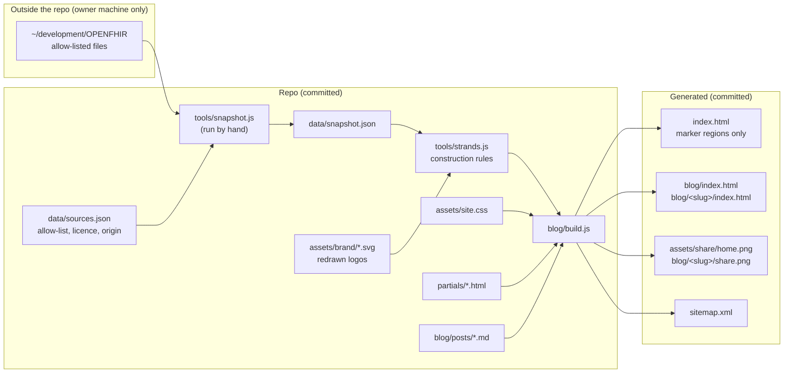

# syntaric.com and Blog Redesign

*   **Author:** Gasper Andrejc
*   **Status:** Proposed
*   **Date:** 2026-11-04

--------------------------------------------------------------------------------

## Overview

syntaric.com is a single static page (`index.html`) plus a blog generated by
`blog/build.js` from markdown in `blog/posts/`. Both are hosted on GitHub
Pages. Most visitors arrive from LinkedIn, on a phone, often inside the
LinkedIn in-app browser.

This design rebuilds the look, the copy and the page structure of both, so
that Syntaric reads as a small, senior healthcare interoperability
consultancy and not as a site made from a template or by an AI generator. The
content of today's sections stays. The layout, order and wording can change.

The work ships in two stages, each deployable on its own:

*   **Stage 0: content and defaults.** Fix defects that hurt every visitor
    whatever the design (no phone navigation, broken LinkedIn previews on
    every post, hotlinked images, analytics loaded without consent). Rewrite
    and fact-check the copy. Remove the template patterns listed in the ban
    list. Merge duplicated sections. Introduce a new typeface and palette
    through one shared stylesheet for the home page and the blog.
*   **Stage 1: the visual system, with motion.** Redraw the Syntaric and Unio
    logos as vectors. Derive a "strand" drawing system from the Syntaric
    feather. Show real FHIR and openEHR data in three places (hero, openFHIR
    block, Unio block). Add one hero motion and at most two scroll moments.
    Generate LinkedIn share cards for the home page and every post.

A Stage 2 runs only if the success tests in this document fail on the
finished Stage 1 build.

## The Problem

Visitors, and the owner's professional peers, read the current site as
generic. The owner's words: "the page is not bad, it's good, but it's
generic and as such it turns me off." For a consultancy whose product is
expert judgement, a page that looks assembled from defaults weakens the
credibility it is meant to build.

The six-lens review in the concepts brief traced the generic feel to four
sources:

1.  **The section skeleton.** Pill label and an H1 with one coloured phrase,
    a scrolling logo strip, a dark stats strip, a 3x2 icon grid, numbered
    pricing-style cards with a "Most popular" badge, a checklist beside a
    diagram, two mirrored product blocks, a logo wall, and "Let's build ...
    together". This is the standard SaaS landing page order.
2.  **Copy and defaults.** Phrases such as "seamless bidirectional
    interoperability" and "leverage the full power of the standard"; the
    Inter typeface with one bright blue accent (`#0052cc`) that matches none
    of the three logos; stock icons that do not match their labels.
3.  **Missing proof.** The strongest credentials and the track record sit far
    below the first mobile screen, as lists of names with no outcomes. Case
    studies, talks and 17 blog posts are not linked from the home page.
4.  **Motion used as decoration.** Load-time fade-ups, an endless marquee and
    animated SVG dots. These are template patterns in themselves.

A lack of motion is not on that list. The owner has decided to include motion
in Stage 1 (decision 10 in the brief), because a "dynamic" page is one of the
three things the owner likes about fire.ly. What this costs: the peer test
can no longer show whether motion or the static changes removed the template
feel. To limit the cost, every motion piece is designed and reviewed first as
a static frame, and Stage 2 starts by removing motion before adding anything.

Several defects also block a good LinkedIn visit under any design:

*   Phones below 640 px get no navigation at all (`index.html:1233-1235`,
    `blog/build.js:178`).
*   Every blog post's LinkedIn preview image points to a folder that does not
    exist (`blog/build.js:241-243`).
*   The home page share card is a 276x266 logo.
*   GA4 sets cookies on EU visitors before any consent, and Google Fonts
    sends visitor IP addresses to Google.
*   The hero background and nine collaborator logos are hotlinked from other
    sites; one over plain `http://`.
*   The Syntaric and Unio logos exist only as PNG files, so nothing can be
    drawn from them at high resolution.

## Goals

1.  **Not a template.** The peer test defined under decision #3 passes on
    the finished Stage 0 + 1 build: at least 4 of 5 peers, on a phone inside
    the LinkedIn app, answer "no" to "template?" and "AI-generated?", and no
    peer names a specific template pattern.
2.  **Understood in 5 seconds.** The 5-second test under decision #3 passes:
    at least 4 of 5 people outside the field, after 5 seconds on the first
    390 px screen, can say what Syntaric does, who it is for, and that it is
    a consultancy that also makes products.
3.  **One primary action.** Every page has one primary call to action, in the
    hero and the nav, leading to the `#contact` block. Product links are
    visibly secondary and lead to the product sites.
4.  **Every piece of current content survives.** Services, engagements,
    track record, both products, collaborators and contact details all remain
    on the page, merged or reordered where useful (decision 9). Verified
    against a content inventory taken from today's `index.html` before work
    starts.
5.  **A visual identity only Syntaric can have.** Shapes are derived from the
    redrawn Syntaric feather by written construction rules, and every piece
    of FHIR or openEHR text shown is valid, legible at reading size at least
    once, and captioned in plain language.
6.  **One design source.** The home page and every blog page take their CSS,
    nav and footer from `assets/site.css`, `partials/nav.html` and
    `partials/footer.html`. `node blog/build.js --check` passes.
7.  **Every blog post is a front door.** Each post has a working 1200x627
    LinkedIn share card, a footer with site navigation, and an end-of-post
    block that says what Syntaric does and links to `#contact`.
8.  **Works in the LinkedIn in-app browser.** The page meets the performance
    budget (decision #15) on a mid-range
    Android and an older iPhone, and is complete with JavaScript off and with
    `prefers-reduced-motion: reduce`. Motion meets WCAG 2.2.2, 2.3.3 and
    2.5.8. axe reports 0 violations.
9.  **The external contract stays.** Every URL in today's `sitemap.xml` (19
    entries) still resolves, and the 8 anchor ids (`services`, `engagements`,
    `expertise`, `products`, `openfhir`, `unio`, `collaborators`, `contact`)
    still exist.
10. **Static and self-hosted.** No runtime data fetching. All fonts, images
    and logos are served from syntaric.com. The only third-party request is
    the GoatCounter script and beacon.

## Non-Goals

*   **Product-first marketing for openFHIR or Unio.** Feature lists and
    product pitches stay on open-fhir.com and unio.syntaric.com. Each product
    gets a fixed, small allowance on this page.
*   **A personal-brand site.** The voice stays "we", with scale stated as "a
    small team" (decision #2).
*   **Looking like fire.ly.** No teal and yellow, no isometric illustrations,
    no stock video, no dark-mode site.
*   **The strand motif everywhere.** It appears in the hero, the openFHIR
    block, the Unio block and thin dividers only. No single strand running
    down the whole page.
*   **Scroll-jacking, pinned scroll sequences, parallax on text, or an
    animation library** in this version.
*   **Motion on the blog.** The blog gets the shared stylesheet, real covers
    and share cards, but no moving illustrations.
*   **Real patient data or client documents** anywhere on the site, including
    as background texture.
*   **A new hosting platform or a build that runs on deploy.** Output is built
    locally and committed. GitHub Pages serves it as files.
*   **A consent banner.** Analytics is cookieless (decision #12).
*   **Moving to a static site generator** or generating `index.html` from a
    separate template (decision #13).

## Open Questions

Numbers refer to "Open decisions the owner must make" in
`.egm/concepts_brief.md`. Each is settled when the section that depends on it
is drafted.

*   **#8 Proof content.** The one proof line and named outcome for the first
    two mobile screens; which 2-3 case studies are cleared for public use.
*   **#9 Item names.** The shared names for the merged "What you can hire us
    for" list.
*   **#10 Licensing facts.** The licence of openFHIR and of Unio, for the
    one-sentence statement in the Products section.
*   **#11 Client list content.** Inclusion rules (healthcare only? Petrol
    Pay?), naming permissions, one line per client on what Syntaric did,
    which entries are "as partner".
*   **#16 Facts only the owner can supply.** Reply time for the contact block,
    exact stats, years and countries, openEHR SEC membership date, the
    `wvs.nl` link, the IHE profile list.
*   **#17 Trademarks.** Whether HL7 FHIR and openEHR logo tiles may be shown.
*   **Company LinkedIn page.** Does a Syntaric company page exist? Required
    by the condition under #2.

## Critical User Journeys (CUJs)

### CUJ 1: A hospital CIO arrives from LinkedIn and gets in touch

*   **Given**: a phone, the LinkedIn app, a post linking to syntaric.com. The
    LinkedIn feed shows the home page share card (1200x627, with a readable
    line saying what Syntaric does).
*   **When**: the visitor taps the link, reads the first screen, and taps the
    primary button.
*   **Then**: the first 390 px screen shows the static H1, the who-for line
    and the primary button before any motion starts. The button scrolls to
    `#contact`, which shows email, phone, LinkedIn and the reply-time
    sentence. Tapping email or phone sends a GoatCounter event.

### CUJ 2: A visitor lands on a blog post and finds the company

*   **Given**: a shared link to `https://syntaric.com/blog/<slug>/` in the
    LinkedIn app. The feed preview shows that post's share card.
*   **When**: the visitor reads the post on a phone and reaches the end.
*   **Then**: the article comes before the table of contents and author card
    on mobile. The post ends with a block saying what Syntaric does and a
    link to `/#contact`. The footer links to the home page sections and the
    blog.

### CUJ 3: A visitor with Reduce Motion, Low Power Mode, Data Saver or no JavaScript

*   **Given**: any of `prefers-reduced-motion: reduce`, Data Saver
    (`navigator.connection.saveData`), a failed or blocked script, or
    JavaScript off.
*   **When**: the visitor loads and scrolls the home page.
*   **Then**: every section shows its finished static frame. No text starts
    hidden. No animation runs. Navigation works (the full link list is shown
    when the menu toggle cannot run).

### CUJ 4: A visitor looking for openFHIR or Unio

*   **Given**: a visitor who came for a product.
*   **When**: they tap the secondary hero link.
*   **Then**: the page scrolls to `#products`. Each product shows its logo,
    one plain outcome sentence, one evidence line, its licence, and a link to
    its own site. Old links to `/#openfhir` and `/#unio` still land on the
    right product.

### CUJ 5: The owner publishes a new post

*   **Given**: a new `blog/posts/YYYY-MM-DD-<name>.md` with front matter.
*   **When**: the owner runs `npm run build`, then `npm run check`, commits
    and pushes.
*   **Then**: the build writes the post page, its share card
    (`blog/<slug>/share.png`), the blog index, the latest-3 block in
    `index.html` and `sitemap.xml`. The check passes. After deploy, the
    post-deploy check passes and LinkedIn Post Inspector shows the card.

## Technical Plan (Architecture)

### Summary

The site stays a set of static files on GitHub Pages. One local Node build
(`blog/build.js`, run by the owner, output committed) does four jobs:

1.  Renders blog posts and the blog index from markdown (as today).
2.  Inlines the shared stylesheet and HTML fragments into every blog page,
    and into marked regions of the hand-edited `index.html`.
3.  Draws the strand figures (hero, openFHIR mapping, Unio fan-out,
    dividers) from the redrawn logo geometry and a committed data snapshot.
4.  Rasterises share cards for the home page and every post.

A separate script, run by hand only when the source data changes, builds the
data snapshot from allow-listed files outside the repo. The build itself never
reads outside the repo.

### Build and data flow



GitHub Pages runs Jekyll over the repo. `_config.yml` excludes `tools/`,
`data/`, `partials/`, `docs/`, `blog/posts/`, `node_modules/`, `package*.json`,
`README.md`, `.idea/`, `etc/syntaric_12.2025.pdf` and
`blog/articles-to-copy.csv`. Files without front matter (all generated HTML)
are copied as they are.

### Repository layout after the change

```text
/
├── _config.yml                 new: Jekyll exclude list
├── index.html                  hand-edited; build rewrites marker regions only
├── assets/
│   ├── site.css                shared stylesheet source (inlined, never linked)
│   ├── motion.js               Stage 1: motion runtime, ES module
│   ├── fonts/                  self-hosted WOFF2 (text face, mono face)
│   ├── brand/                  syntaric.svg, unio.svg, openfhir.svg (redrawn / verified)
│   ├── img/                    product screenshots, case-study images
│   └── share/home.png          generated share card
├── partials/                   nav.html, footer.html, post-contact.html,
│                               figures/*.svg (generated strand figures)
├── tools/                      strands.js, share-card.js, markers.js,
│                               snapshot.js, check-links.js, check-deploy.sh
├── data/                       sources.json, snapshot.json
├── blog/
│   ├── build.js                entry point, as today
│   ├── posts/*.md              sources, as today
│   └── <slug>/                 index.html, cover image, share.png
└── sitemap.xml
```

### Shared design source (decision #13)

*   `assets/site.css` holds every style: tokens (`:root` colours, type
    scale, spacing, one easing curve, two durations), base, nav, footer,
    home-page sections and blog templates. It replaces the `<style>` block in
    `index.html` and `SHARED_CSS` plus the page-specific CSS in
    `blog/build.js`.
*   The build inlines the file into each page inside `<style>`. The file is
    split into three blocks by comment lines: `/* @shared */`,
    `/* @page home */` and `/* @page blog */`. Home receives shared + home;
    blog pages receive shared + blog. This keeps each page's inline CSS
    inside the HTML budget.
*   `tools/markers.js` finds `<!-- @name -->…<!-- /@name -->` pairs in
    `index.html` and replaces their content. Regions: `css`, `nav`, `footer`,
    `latest-posts`, `hero-figure`, `openfhir-figure`, `unio-figure`,
    `divider-1` … `divider-n`. A missing, duplicated or unbalanced marker
    stops the build with an error.
*   `--check` mode runs the whole build in memory and compares the result
    with the files on disk, without writing. Any difference exits non-zero
    and lists the files.

### Page structure (home)

The section order is the one adopted in the Decisions Log (#8-#11). All 8
anchor ids keep working: `services`, `engagements`, `expertise`, `products`,
`openfhir`, `unio`, `collaborators`, `contact`. The nav lists, in page
order: Services, Selected work, Products, Writing, Contact (primary button),
plus Blog. Nav labels match the section headings.

The first mobile screen (390x844, minus LinkedIn's in-app toolbar) shows, as
static HTML in this order: logo and nav, H1, who-for line, primary button,
secondary product link. The hero figure sits below the text on phones.
From 960 px up it is a background layer filling the hero, behind the text
(brief 4.2, reconciled at Step 6):

*   A fixed text zone (the bounding box of the H1, who-for line and buttons,
    plus 32 px padding) is cut out of the figure. No strand, label or video
    pixel inside it has a contrast above 1.2:1 against the ground `#f6f3ee`
    (the ratio of a 10% navy tint, `#dfdfde`), in any frame of the motion.
*   Strands are drawn in light navy tints; the mono data labels on the
    strands sit outside the text zone at full ink, so they stay legible.
*   The text is real HTML layered above the figure with `position:
    relative`; the figure is `position: absolute`, `aria-hidden`, and does
    not affect layout, so it cannot shift the text (CLS).
*   The same rule applies to the video if Prototype B wins: its poster and
    every frame keep the text zone clear.

### Visual system (Stage 1)

The visual system is built in a fixed order, each step gated on the one
before:

1.  **Logo redraw.** The Syntaric and Unio marks are redrawn by hand as SVG
    (`assets/brand/`). Check: overlay on the source PNG at 100% and 400% and
    look for drift. The openFHIR SVG is compared with the redrawn feather.
    The owner signs off. The redraw also replaces `favicon.svg` (today a
    base64 PNG in an SVG wrapper) and the PNG icons.
2.  **Construction rules.** `tools/strands.js` encodes the rules measured
    from the signed-off feather:
    *   **profile**: the taper curve of one blade, as a cubic Bezier width
        function along the strand;
    *   **gap**: the channel between strands, equal to the white gap between
        the two blades;
    *   **notch**: the notched blade tip, used only as a terminal where a
        strand meets a data endpoint;
    *   **count**: 2 (Syntaric), 2 in fire colours (openFHIR), 3 into the
        ring (Unio).
    *   Banned by construction: glow, blur, bloom, particles, mesh gradients,
        neon on dark grounds. The module exposes no parameter for them.
    The rules are also written down in `docs/strand-rules.md` with figures, so
    a person can check a drawing against them.
3.  **Figures.** `tools/strands.js` produces four SVG figures into
    `partials/figures/`. The hero figure is drawn first and goes through the
    prototype gate (#4); the other three are drawn only after the gate, so a
    gate result that changes the rules does not force redrawing them:
    *   **hero**: two strands carrying a FHIR path and the matching openEHR
        path, ending aligned;
    *   **openfhir**: one AllergyIntolerance's fields running to their
        openEHR paths;
    *   **unio**: one query fanning out to three repositories, one marked
        unreachable, the result marked partial;
    *   **divider**: a hairline strand with a mono margin note.
    Each figure is drawn in its finished state. Every text node in a figure
    comes from `data/snapshot.json`. Every figure has a plain-language
    caption in the HTML, outside the SVG.
4.  **Accessibility of figures.** Every figure SVG has `aria-hidden="true"`,
    `focusable="false"` and no `<title>`. Its wrapper has `data-nosnippet`.
    The caption carries the meaning.

### Data snapshot

*   `data/sources.json` is the allow-list. Each entry: absolute source path,
    the mapping names to extract, licence and origin; or a synthetic entry
    whose text is written by hand (the Unio figure).
*   `tools/snapshot.js` (run by hand) reads only the listed paths and
    rejects any path under `~/Documents/syntaric/_clients/`. It copies only
    the `select` part of each source, unchanged, into `data/snapshot.json`
    with its source and licence.
*   **Filtering happens at build time** (brief 8.1, reconciled at Step 6).
    `blog/build.js` loads the snapshot through `tools/data-rules.js`, which
    removes, on every build: strings matching placeholder patterns ("Lorem
    ipsum", "DOE, John", "No example for"), the fields `name`,
    `identifier`, `telecom`, `address` and `birthDate`, and any base64 value
    longer than 64 characters. The build logs each removal and fails if a
    figure's text exceeds 8 KB after filtering. A rule added later applies to
    the next build with no snapshot refresh.
*   **Known cost:** the committed `data/snapshot.json` holds the selected
    values before filtering, so test-patient names and identifiers from
    spec examples sit in the repo and its history. `data/` is excluded from
    publishing (#14), but if the GitHub repo is public they are readable
    there. The `select` field keeps the extract to the parts a figure uses.
*   The one file source:
    `~/development/OPENFHIR/ZIB-EHDS-hackathon/infrastructure/fhirconnect/EHDS/allergies/eps.adverse_reaction_risk.v2.yml`
    (FHIR path to openEHR path pairs). It feeds the hero, the openFHIR
    figure and the divider notes. The Unio figure uses synthetic text.
*   Paths are shown expanded (`$resource` and `$archetype` replaced from
    the mapping file's header). No separate validation record is kept: the
    text comes unchanged from a published mapping.

### Hero prototype gate (decision #4)

Both prototypes use the hero figure from step 3 as their static frame.

*   **Prototype A (SVG motion):** `assets/motion.js` animates the hero figure
    once, for 5 s or less, using only `transform`, `opacity` and
    `stroke-dashoffset`. Text moves as whole groups.
*   **Prototype B (MP4):** the same motion, rendered frame by frame to a
    muted MP4 (H.264, no audio track) and played in a `<video muted
    playsinline>` with the static SVG as its poster. The video file loads
    only after `load` and only when Data Saver is off. Because it loops, it
    has visible pause and play controls.
*   The gate inputs and owner choice are as in the Decisions Log (#4). After
    the gate, the losing prototype's files are deleted.

### Motion runtime (Stage 1, applies if Prototype A wins; the scroll moments apply either way)

*   An inline script in `<head>` adds `js` to `<html>`. All motion CSS is
    scoped under `html.js.motion-ok`. Without the class, CSS shows every
    figure in its finished state.
*   The same inline script adds `motion-ok` before first paint only if
    `prefers-reduced-motion` is not `reduce` and
    `navigator.connection.saveData` is not true, so the start state is
    painted from the beginning. A 3 s timeout removes `motion-ok` unless
    `assets/motion.js` has started, so a failed script still ends on the
    finished figure.
*   `assets/motion.js` is loaded with `<script type="module">` and starts
    after the `load` event; it removes `motion-ok` if the page is hidden.
*   Figures opt in through data attributes, not section-specific code:
    `data-motion="draw|align|fanout"` and `data-motion-start="load|view"`.
    `view` uses one `IntersectionObserver` (threshold 0.4), plays once, and
    unobserves.
*   Motion vocabulary: draw (`stroke-dashoffset`), align (`transform`),
    fan-out (`transform` and `opacity`). One easing curve, two durations,
    both from CSS custom properties.
*   No loops in v1. So no pause control is needed for SVG motion (WCAG
    2.2.2 applies only to motion longer than 5 s or repeating).
*   Pausing: a `visibilitychange` listener cancels running animations and
    jumps them to their end state. A reduced-motion change at runtime does
    the same.
*   No animation library, no pinning, no scroll-jacking, no `preventDefault`
    on touch. Section heights use `svh` units.
*   At most two scroll moments: the openFHIR figure and the Unio figure,
    both `data-motion-start="view"`.

### Typography and first paint

*   Two self-hosted WOFF2 files (text face, mono face), chosen under #7.
    The text face is preloaded. Both use `font-display: swap` with a
    size-adjusted local fallback (`size-adjust`, `ascent-override`,
    `descent-override`) so the swap shifts layout by almost nothing.
*   The H1, intro and buttons have no entry animation and are never hidden
    at load.

### Navigation

*   `partials/nav.html` holds one nav for the home page and the blog. Below
    640 px, a menu button (`aria-expanded`, `aria-controls`, at least 24x24
    px) opens the full list. Contact and Blog stay visible next to the
    button at all widths. Without JavaScript, the full list shows as a
    wrapping row. The toggle pattern follows
    `/home/gandrejc/development/SYNTARIC/unio-landing/index.html:109`.
*   On the blog, links use root-absolute paths (`/#services`). On the home
    page they use `#services`. The build writes the right form for each page
    type. One path convention per page type; no `..` paths.

### Blog changes

*   Post template: article first on mobile; the table of contents and author
    card follow it. End-of-post block from `partials/post-contact.html`.
    Footer from `partials/footer.html`. No glow blobs, no gradient post
    hero, no icon pool. Listing cards use each post's real cover image.
*   `blog/posts/2026-04-15-ips-on-openehr-webinar.md:23-84`: inline styles
    restyled by hand to the new tokens. Its pdf.js is self-hosted, and its
    global `window.pdfChangePage` is renamed to avoid clashes.
*   Posts with `publish: false` are still written (as today) but get
    `<meta name="robots" content="noindex, nofollow">` (as today) and use
    the home share card.
*   Read time is computed once from the markdown body and used everywhere.
*   Sitemap `lastmod` comes from front matter `updated`, falling back to
    `date`, not from the build date.
*   `marked` is pinned to an exact 12.x version, because a major upgrade
    would change table-of-contents anchor ids.

### Share cards and link previews

*   `tools/share-card.js` builds a 1200x627 SVG (Syntaric navy strands drawn
    by `tools/strands.js`, the redrawn logo, a title in the text face, the
    line "Healthcare interoperability consultancy" in the mono face) and
    rasterises it with `@resvg/resvg-js`. resvg cannot read WOFF2, so TTF
    copies of the same two faces are kept in `tools/fonts/` (excluded from
    publishing).
*   Home: `assets/share/home.png`. Each published post:
    `blog/<slug>/share.png`, with the post title broken into at most 3
    lines.
*   Every page sets `og:image` to the absolute URL of its card, plus
    `og:image:width` 1200, `og:image:height` 627, `og:image:alt`, and
    `twitter:card` `summary_large_image`.
*   Article JSON-LD: `image` = the share card, `publisher.logo` = a PNG of
    the redrawn Syntaric logo, `dateModified` from `updated` or `date`.
    Organization `@id` stays `https://syntaric.com/#organization`; `sameAs`
    follows the condition under #2.

### Analytics (decision #12)

*   GoatCounter's `count.js` is loaded with `async` on every page, the home
    page and blog alike (today the blog index has no analytics at all).
*   Named events through `data-goatcounter-click` on: email links, phone
    links, LinkedIn links, product links out, primary button.
*   No other data is sent: no Core Web Vitals, JS errors or fallback
    reports from real visitors (reconciled at Step 6). Performance and
    fallbacks are checked in the lab and on devices only (Verification
    Plan).
*   LinkedIn links to the site carry UTM parameters, because the in-app
    browser often drops the referrer.

### Assets and hotlinks

*   The hero and blog background images from `open-fhir.com` are removed.
*   Client and partner logos are not shown; the client list is text
    (decision E4). The hotlinked logo images leave with the old
    collaborator section.
*   The nine JPGs in the repo root (`analytics-firely-server.jpg` and
    others) are deleted. Nothing references them at their current path; they
    only share names with the broken `/blog/images/<slug>.jpg` preview URLs.
    They are not in `sitemap.xml`.
*   `images/architecture.svg` is replaced by the openFHIR figure.
    `images/interoperability.svg` (unreferenced) is deleted.
*   Every `` gets `width` and `height`. Images below the first screen
    are lazy-loaded; the first-screen image never is. New raster images
    under `assets/img/` are served as AVIF or WebP with `srcset`; existing
    blog covers keep their formats (decision E5).
*   HL7 FHIR and openEHR logos are not shown until #17 is settled.

### Performance budget

As settled under #15 in the Decisions Log: brief 9.1 with one third-party
request, and a separate 1.5 MB cap for a hero video if Prototype B wins.

### Rollout and rollback

*   Stage 0 ships first, as separate commits for the home page and the
    blog, so each can be reverted with `git revert`. The mobile nav and the
    LinkedIn preview fix are the first commits.
*   Stage 1 ships after the hero gate and the static-frame review.
*   GitHub Pages caches for about 10 minutes; a revert is live after that.
    LinkedIn caches previews per URL; after a card change, Post Inspector is
    used to refresh each changed URL.

## Alternatives Considered

Sources: the "Alternatives Weighed" table in `.egm/concepts_brief.md` (lens
names in brackets), and options the owner turned down while settling the
blockers for this document.

### Scope and staging

#### Keep the exact section skeleton and reskin it

*   **Pros**: lowest risk; no content moves; no anchor changes.
*   **Cons**: the template rhythm (pill, marquee, stats strip, icon grid,
    tier cards, logo wall) is the main source of the generic feel.
*   **Reason for Rejection**: owner decision 9. Content must survive; layout
    may change. [structural, zoom-out]

#### Static first, motion only if peers still say "template"

*   **Pros**: the peer test could show whether motion was needed; less to
    build and maintain if it was not.
*   **Cons**: the owner named "dynamic" as one of three things liked about
    fire.ly; shipping without motion would miss that intent.
*   **Reason for Rejection**: owner decision 10. Some of the checkpoint value
    is kept: static mockups are peer-tested first, static frames are
    reviewed before motion is added, and Stage 2 starts by removing motion.

#### Full motion and illustrations on the blog in the same pass

*   **Pros**: one visual language everywhere.
*   **Cons**: roughly doubles the motion work; posts are read, not browsed.
*   **Reason for Rejection**: deferred. The blog gets the shared stylesheet,
    real covers and share cards. [zoom-out, structural]

### Hero medium and motion technology

#### Stock or AI-generated hero video (fire.ly style)

*   **Pros**: matches what the owner first described as "dynamic".
*   **Cons**: stock footage is the fire.ly look and the current problem;
    autoplay is unreliable in the LinkedIn app; third-party video needs
    cookie consent; the AI infographic in `_marketing` shows the artefacts
    to avoid.
*   **Reason for Rejection**: works against the main goal. [design,
    implementation-readiness, zoom-out]

#### Commit to one hero medium now, without a prototype gate

*   **Pros**: no throwaway prototype; a single path through the
    implementation plan.
*   **Cons**: SVG may not match the owner's expectation of a video; MP4 has
    blurry text, 0.5-2 MB weight and unreliable autoplay. Neither risk can be
    judged without seeing both on a phone.
*   **Reason for Rejection**: owner decision #4. Both are prototyped on a
    shared static frame, and the owner picks at a gate.

#### Atlas 2.1 product video in the hero

*   **Pros**: real footage of real work.
*   **Cons**: it describes a product, not the consultancy.
*   **Reason for Rejection**: rejected for the hero; allowed compressed,
    muted and click-to-play inside the openFHIR block. [design, zoom-out]

#### WebGL hero

*   **Pros**: the most freedom in rendering.
*   **Cons**: weight and battery cost far exceed the job; no static no-JS
    state.
*   **Reason for Rejection**: disproportionate. [implementation-readiness]

#### Canvas-only hero with text drawn in canvas

*   **Pros**: smooth particle-style motion.
*   **Cons**: no static no-JS state; runs on the main thread; text in canvas
    is invisible to search and assistive technology.
*   **Reason for Rejection**: inline SVG with a finished default state is
    used instead. [implementation-readiness]

#### Animating SVG `textPath` offsets every frame

*   **Pros**: text that flows along a strand.
*   **Cons**: re-lays out every glyph each frame; slow in WebKit, which every
    iOS in-app browser uses.
*   **Reason for Rejection**: performance on the main target. Text moves as
    whole groups. [implementation-readiness, design]

#### Animation library (GSAP with ScrollTrigger, about 35 KB)

*   **Pros**: mature timeline and scroll tooling.
*   **Cons**: exceeds the 15-20 KB motion JS budget; pinning misbehaves as
    the in-app toolbar resizes the viewport.
*   **Reason for Rejection**: not needed for three one-shot motions.
    [implementation-readiness, zoom-out, design]

### Visual system

#### One continuous strand down the whole page

*   **Pros**: a single, memorable device.
*   **Cons**: every content edit becomes animation tuning; highest
    performance risk; stamping one motif everywhere is itself a template
    move.
*   **Reason for Rejection**: three anchor places plus dividers instead.
    [structural, design]

#### Unio's three strands as the master motif

*   **Pros**: the most strand-like of the three marks.
*   **Cons**: the company would read as its product; the Unio mark has no
    clean vector.
*   **Reason for Rejection**: the Syntaric feather is the master motif.
    [structural, comprehension, design]

#### Blending all three logos into one hero motif

*   **Pros**: shows the whole family at once.
*   **Cons**: signals "one platform with three parts", pushing toward a
    product-company reading.
*   **Reason for Rejection**: product shapes stay in their own blocks.
    [comprehension]

#### Auto-tracing the PNG logos

*   **Pros**: fast.
*   **Cons**: heavy, slightly wrong paths on the company's own mark; carries
    over Unio's soft raster edges.
*   **Reason for Rejection**: hand redraw with an overlay check and owner
    sign-off. [implementation-readiness, codebase-details]

#### Dark-mode site or dark teal hero

*   **Pros**: a dark ground makes strands stand out.
*   **Cons**: pulls toward Firely and the glowing-strand AI look.
*   **Reason for Rejection**: light ground with Syntaric navy. The Unio
    screenshot may stay as the one dark element. [design]

#### Serif headlines with mono labels as the type answer

*   **Pros**: easy contrast between voice and data.
*   **Cons**: itself the 2024-26 AI-startup look.
*   **Reason for Rejection**: kept as a caution, not banned. Distinctiveness
    comes from what the mono shows (real paths), not from the pairing.
    Settled under #7. [design]

### Data

#### Live fetching of FHIR or openEHR data

*   **Pros**: always current.
*   **Cons**: static host; privacy risk; figures break if a source changes.
*   **Reason for Rejection**: committed, allow-listed snapshot.
    [structural, codebase-details]

### Positioning and contact

#### "Boutique interoperability company" kept out of page copy entirely

*   **Pros**: avoids the premium and clothing-shop readings of "boutique"
    and the integration-vendor reading of "company". [comprehension]
*   **Cons**: drops the owner's own term for the firm.
*   **Reason for Rejection**: partly overridden by the owner (#2). The H1 uses
    "Boutique healthcare interoperability consultancy". "Consultancy"
    replaces "company", and the 5-second test checks the reading.

#### Direct `mailto:` as the primary call to action

*   **Pros**: one tap; nothing to maintain.
*   **Cons**: in the LinkedIn in-app browser on phones without a mail app,
    the tap does nothing or opens an empty setup screen.
*   **Reason for Rejection**: the primary button goes to the `#contact`
    block, which offers email, phone and LinkedIn.

#### Booking service (Cal.com or Calendly) as the primary call to action

*   **Pros**: the lowest effort for a busy CIO.
*   **Cons**: a third party with likely cookies; a common SaaS-template sign;
    the owner's calendar becomes the bottleneck.
*   **Reason for Rejection**: conflicts with the consent decision and the
    "not a template" goal.

#### Naming the lead architect, or a named core team plus partners

*   **Pros**: fixes the gap between "we" and a personal LinkedIn profile;
    answers capacity doubts (partners option).
*   **Cons**: naming one person pulls toward a personal brand (owner decision
    3) and raises single-point-of-failure doubts; a partner bench must be
    real and the partners must agree to be named.
*   **Reason for Rejection**: owner chose "a small team" without names (#2),
    with the LinkedIn link condition.

### Success test

#### Peer test with a threshold only, named tells logged as a fix list

*   **Pros**: one peer's remark cannot fail the whole run.
*   **Cons**: a named tell is direct evidence the goal was missed.
*   **Reason for Rejection**: owner kept brief 10.1 as written (#3).

#### No fixed pass threshold

*   **Pros**: flexible.
*   **Cons**: nothing defines "tests failed", so Stage 2 has no trigger.
*   **Reason for Rejection**: the staging depends on a pass rule.

### Analytics and consent

#### Keep GA4 and add a consent banner

*   **Pros**: free; GA4 history continues.
*   **Cons**: a banner on the first mobile screen, where the peer test is
    judged; data only from visitors who opt in, which skews the baseline.
*   **Reason for Rejection**: owner chose cookieless analytics (#12).
    [implementation-readiness]

#### No analytics

*   **Pros**: zero third parties; nothing to maintain.
*   **Cons**: no baseline and no conversion events.
*   **Reason for Rejection**: owner chose cookieless analytics (#12); brief
    10.2 asks for a baseline and conversion events.

#### Plausible or Cloudflare Web Analytics instead of GoatCounter

*   **Pros**: Plausible has richer events and EU hosting; Cloudflare is free
    and reports Core Web Vitals.
*   **Cons**: Plausible is a monthly subscription; Cloudflare has no custom
    events, as far as was known when drafting, and is a US company.
*   **Reason for Rejection**: owner chose GoatCounter (#12).

### Build and hosting

#### `build.js` generates `index.html` from a `src/` template

*   **Pros**: one source with no hand-edited generated file; no marker
    regions.
*   **Cons**: every home-page edit needs a build; editing the root
    `index.html` by mistake is lost on the next build.
*   **Reason for Rejection**: owner chose shared CSS plus fragments with
    marker regions (#13).

#### Move to a static site generator (for example Eleventy)

*   **Pros**: partials, collections and data files built in.
*   **Cons**: rewrites the parts of `build.js` worth keeping; a new framework
    dependency; risk of changing table-of-contents anchor ids, which are part
    of the URL contract.
*   **Reason for Rejection**: owner decision #13.

#### `.nojekyll` with private files moved out of the repo

*   **Pros**: what is committed is exactly what is served.
*   **Cons**: post sources, partials, `.idea/` and private files would all be
    public unless moved out of the repo; underscore-folder exclusion is lost
    too.
*   **Reason for Rejection**: owner chose Jekyll with an exclude list (#14).

#### GitHub Actions deploy of an allow-listed `dist/`

*   **Pros**: an allow-list instead of a deny-list.
*   **Cons**: a build on deploy (a Non-Goal); changes custom-domain handling.
*   **Reason for Rejection**: owner decision #14.

### Share cards

#### Headless browser screenshots of an HTML card

*   **Pros**: real CSS layout and text wrapping.
*   **Cons**: a browser download of a few hundred MB; slow; renders can drift
    between browser versions, making noisy diffs in committed images.
*   **Reason for Rejection**: `@resvg/resvg-js` chosen instead.

#### Hand-made cards per post

*   **Pros**: no dependency; full control per card.
*   **Cons**: a manual step on every post that can be forgotten, which is
    how the current previews broke.
*   **Reason for Rejection**: cards are generated by the build.

### Page structure

#### Keep collaborators as a separate section from the client list

*   **Pros**: keeps the difference between partners and clients visible.
*   **Cons**: the same names appear twice with lists that disagree (brief
    5.4).
*   **Reason for Rejection**: one grouped list, with partners marked "as
    partner" per entry.

--------------------------------------------------------------------------------

## Non-Functional Requirements

*   **Privacy:** no cookies; one cookieless analytics service; fonts and all
    images self-hosted. No patient data or client documents in the repo;
    `tools/snapshot.js` refuses `~/Documents/syntaric/_clients/`. Private
    files are kept out of the published site by `_config.yml` and checked
    after every deploy.
*   **Performance:** the budget under #15, measured as in the Verification
    Plan.
*   **Accessibility:** WCAG 2.2 AA; motion rules 2.2.2, 2.3.3, 2.5.8; every
    page complete with no JavaScript and with reduced motion.
*   **Rollout and rollback:** as in the Technical Plan. Each numbered commit
    below can be reverted on its own with `git revert`.

--------------------------------------------------------------------------------

### Additional Resources

*   `.egm/concepts_brief.md`: six-lens brainstorm brief; section numbers
    cited as "brief N.N" throughout.
*   `.egm/concept_context.md`: owner intent, current site and fire.ly
    observations.
*   `.egm/screens/`: screenshots of the current hero and fire.ly.
*   `/home/gandrejc/development/SYNTARIC/unio-landing/index.html:109`:
    accessible nav toggle reused for the mobile menu.
*   `~/development/OPENFHIR/ZIB-EHDS-hackathon/infrastructure/fhirconnect/EHDS/allergies/eps.adverse_reaction_risk.v2.yml`:
    first data source for the strand figures.

### Future Improvements

*   **Atlas 2.1 product video in the openFHIR block**, compressed, muted and
    click-to-play (allowed by the brief, not scheduled).
*   **Motion or figures on the blog**, after the home page passes the tests.
*   **An allow-list deploy** (GitHub Actions publishing only `dist/`), if the
    exclude list in `_config.yml` lets a private file through.

--------------------------------------------------------------------------------

## Detailed Implementation Plan

### Owner inputs and the `TODO-OWNER` rule

Some content can only come from the owner. The implementer must not invent
it. Where an input is missing, the source gets the literal marker
`TODO-OWNER: <what is needed>`. `npm run check` fails if any file the build
writes, `index.html`, or any file under `preview/` contains `TODO-OWNER`, so
a page with a missing fact cannot pass the pre-commit check. `docs/` and
`.egm/` are not scanned.

| Input | Needed by | Source decision |
|---|---|---|
| Proof line and one named outcome for the first two mobile screens | Commit 0.5a | #8 |
| 2-3 case studies cleared for public use (client, problem, what Syntaric did, result) | Commit 0.6 | #8 |
| Names for the merged "What you can hire us for" items | Commit 0.5a | #9 |
| Licence of openFHIR and of Unio | Commit 0.6 | #10 |
| One outcome sentence and one evidence line for openFHIR and for Unio | Commit 0.6 | #10 |
| Client list: inclusion rules, naming permissions, one line each, "as partner" flags | Commit 0.6 | #11 |
| Reply time for the contact block; exact stats, years, countries; openEHR SEC membership date; the correct VWS link; the corrected IHE profile list | Commit 0.6 | #16 |
| Syntaric company LinkedIn page URL, or approval to label the personal profile | Commit 0.6 | #2 |
| Whether HL7 FHIR and openEHR logos may be shown (default: not shown) | Commit 1.5 | #17 |
| GoatCounter account code (e.g. `syntaric`) | Commit 0.4 | #12 |
| Sign-off of the redrawn Syntaric and Unio marks | Commit 1.2 (tooling starts only after it) | Owner decision 11 |
| Hero gate choice (A or B) | Commit 1.4 | #4 |

### Commit order

Each numbered commit is self-contained and can be deployed and reverted on
its own. Stage 0 commits come first; the first three fix defects that hurt
every visitor today.

*   **0.1** Stop publishing private and duplicate files.
*   **0.2** Fix blog LinkedIn preview URLs.
*   **0.3** Shared stylesheet, partials, marker regions and mobile nav.
*   **0.4** Analytics and fonts: remove GA4 and Google Fonts; add GoatCounter
    and self-hosted Atkinson Hyperlegible. Deployed at least two weeks
    before 0.6, so GoatCounter records a baseline of the old page (brief
    10.2). The fonts change the look of the old page in that window; that
    is accepted.
*   **0.5a** Peer-test mockups (first run of both tests under #3); deleted
    after the tests. The values they settle are frozen in
    `docs/design-tokens.md`.
*   **0.5** Blog templates in the new system, built from
    `docs/design-tokens.md`.
*   **0.6** Home page restructure and copy rewrite.
*   **0.7** Self-host remaining assets; image hygiene; manifest.
*   **1.1** Redrawn logos and icons; owner signs off both marks.
*   **1.2** Construction-rule tooling and data snapshot (after sign-off).
*   **1.3** Hero static frame and Prototypes A and B (on unlisted preview
    pages).
*   **1.4** Gate: owner picks; loser and preview pages deleted; winner
    added to the home page.
*   **1.5** Remaining static figures (openFHIR, Unio, divider); owner
    reviews the complete static system.
*   **1.6** The two scroll moments (the runtime exists since 1.3).
*   **1.7** Share cards and link-preview metadata.

### Target Files to Create/Modify/Delete

Line numbers refer to the files at commit `55c5d76`, before commit 0.1.
Earlier commits move them. Find each place by the symbol, selector or string
named next to the number.

#### Commit 0.1: stop publishing private and duplicate files

##### 1. `_config.yml` (Create)

*   **Type / Scope**: Jekyll configuration for GitHub Pages.
*   **Proposed Changes**: an `exclude:` list with `tools/`, `data/`,
    `partials/`, `docs/`, `blog/posts/`, `blog/articles-to-copy.csv`,
    `etc/syntaric_12.2025.pdf`, `node_modules/`, `package.json`,
    `package-lock.json`, `README.md`, `.idea/`. No theme, no plugins added.
*   **Why**: today GitHub Pages serves the CSV, the PDF and `package.json`,
    and renders all 17 post sources as duplicate pages (decision #14).

##### 2. `tools/check-deploy.sh` (Create)

*   **Type / Scope**: shell script run by hand after each deploy.
*   **Proposed Changes**: requests a fixed list of URLs with `curl` and
    compares status codes. Must return 200: `/`, `/blog/`, every URL in
    `tools/sitemap-baseline.txt`. Must return 404: every
    `/blog/posts/<file>.html` for the current post files, `/blog/articles-to-copy.csv`,
    `/etc/syntaric_12.2025.pdf`, `/package.json`, `/partials/nav.html`,
    `/tools/strands.js`, `/data/snapshot.json`, `/docs/strand-rules.md`,
    `/docs/strand-rules.html`.
    Exits non-zero and prints each mismatch.
*   **Why**: the exclude list is a deny-list; this is its guard (#14).

##### 3. `tools/sitemap-baseline.txt` (Create)

*   **Type / Scope**: frozen list of the 19 URLs in today's `sitemap.xml`.
*   **Why**: the URL contract (Goal 9). Used by `tools/check-links.js` and
    `tools/check-deploy.sh`.

##### 4. Root JPGs (Delete)

*   **Files**: `analytics-firely-server.jpg`,
    `data-first-use-case-driven-interoperability.jpg`,
    `extending-firely-server-fhir-ds4p.jpg`, `fhir-server-xds.jpg`,
    `firely-server-openehr.jpg`, `pragmatic-approach-interoperability.jpg`,
    `renaissance-vitalys-interoperable-core.jpg`,
    `virtual-mdt-meetings-interoperability.jpg`, `vitaly-going-nuts.jpg`.
*   **Why**: unreferenced at their path; leftovers of an unfinished preview
    fix. Not in the sitemap.

##### 5. `images/interoperability.svg`, `images/icon_only.png` (Delete)

*   **Why**: unreferenced anywhere in the site.

#### Commit 0.2: fix blog LinkedIn preview URLs

##### 6. `blog/build.js` (Modify, first change)

*   **Type / Scope**: Node build script.
*   **Proposed Changes**: in `buildPostPage` (today lines 241-243), build
    `og:image`, `twitter:image` and a new Article JSON-LD `image` property
    from the post's real cover: resolve the front matter `image` path (e.g.
    `../../blog/<slug>/cover.png`) to the absolute URL
    `https://syntaric.com/blog/<slug>/<file>`. Set JSON-LD `publisher.logo`
    to `https://syntaric.com/etc/syntaric_logo_2.png`; today it wrongly
    reuses `imgUrl` (line 263). Add `og:image:alt` (post
    title). Set `twitter:card` to `summary_large_image`. Width and height
    tags are added in commit 1.7, when every card is exactly 1200x627.
*   **Why**: every post's preview image is a 404 today (brief 7.1). This
    ships before the redesign.

##### 7. `blog/<slug>/index.html`, `blog/index.html`, `sitemap.xml` (Modify, generated)

*   **Why**: regenerated by `node blog/build.js` (`npm run build` from
    commit 0.3) in this and every later commit
    that changes `blog/build.js`, partials or CSS.

#### Commit 0.3: shared stylesheet, partials, markers, mobile nav

##### 8. `assets/site.css` (Create)

*   **Type / Scope**: the single stylesheet source.
*   **Proposed Changes**: three blocks marked `/* @shared */`,
    `/* @page home */`, `/* @page blog */`, holding today's styles from the
    `index.html` `<style>` block and `blog/build.js` (`SHARED_CSS` and the
    page CSS), ported without visual change, plus the styles for the mobile
    menu (item 9).
    *   Nested rules are flattened while porting (today `blog/build.js:342`
        nests `.article-sidebar` inside `.article-layout`).
    *   No nested CSS (older WebViews, brief 6.4), no `animation-timeline`.
    *   The new fonts, tokens and layouts are added by items 17a, 20a and
        26a.
*   **Why**: one design source for home and blog (decision #13, Goal 6).
    The commit only moves code; the new look lands in 0.4-0.6.

##### 9. `partials/nav.html` (Create)

*   **Type / Scope**: HTML fragment with `{{root}}` placeholder for link
    prefixes (empty on home, `/` on blog).
*   **Proposed Changes**: logo link to `/` on every page, the menu button
    (`aria-expanded`, `aria-controls="site-nav"`, at least 24x24 px, label
    "Menu"), today's list and targets (`index.html:1277-1283`: Services,
    Engagements, Our products, Expertise, Collaborators, Blog), and the
    primary "Contact" button to `{{root}}#contact`. The Blog link carries a
    `{{blogCurrent}}` placeholder, filled with ` aria-current="page"` on blog
    pages and empty on home; it replaces `navHtml`'s `activeBlog` flag.
    Contact and Blog stay visible beside the button below 640 px. A tiny
    inline script toggles `nav-open` on `<body>` and flips `aria-expanded`,
    as `/home/gandrejc/development/SYNTARIC/unio-landing/index.html:109`
    does, with its inline `onclick` moved into the script. Without
    JavaScript, CSS shows the full list as a wrapping row. The new labels
    and order arrive in commit 0.6 (item 25).
*   **Why**: phones get no navigation today (brief 5.7).

##### 10. `partials/footer.html` (Create)

*   **Type / Scope**: HTML fragment with `{{root}}`.
*   **Proposed Changes**: site navigation (all home sections, Blog,
    Contact), contact email and phone, the legal lines kept from today's
    footer (`index.html:1827-1839`), the year as literal text (today
    `&copy; 2026`), edited by hand.
*   **Why**: footers have no links today (brief 5.9).

##### 11. `tools/markers.js` (Create)

*   **Type / Scope**: Node module used by `blog/build.js`.
*   **Proposed Changes**: `replaceRegions(html, { name: content })` finds
    `<!-- @name -->` ... `<!-- /@name -->` pairs and replaces their inner
    content. Errors on a missing, duplicated or unbalanced marker.
    `listRegions(html)` returns the names found.
*   **Why**: decision #13.

##### 12. `blog/build.js` (Modify, second change)

*   **Proposed Changes**:
    *   Remove `SHARED_CSS` (lines 124-193), `navHtml` (197-215) and
        `FOOTER_HTML` (217-227). Read `assets/site.css`, split it by the
        `@shared` / `@page` comments, and read the partials, once per build.
    *   Post and index templates inline shared + blog CSS and the partials
        with `{{root}}` = `/`.
    *   After the blog, update `index.html` through `tools/markers.js`:
        regions `css` (shared + home CSS), `nav`, `footer` with `{{root}}`
        empty. Region `latest-posts` is added in commit 0.6.
    *   `--check` flag: run the whole build in memory, compare every output
        with the file on disk, write nothing, print differing paths, exit 1
        on any difference. Also fails on any `TODO-OWNER` in the files
        listed under the `TODO-OWNER` rule. The build output must not
        depend on the current date or time, so the sitemap `lastmod` rule
        of item 20 lands here: each post from `updated`, else `date`;
        `/blog/` the newest of those; `/` none.
    *   `--root <dir>` option builds another checkout (used by the tests).
    *   Blog templates also get the `js` class script first in `<head>`, so
        the mobile menu works there too.
    *   Pin behaviour: no change to the `marked` renderer signature.
*   **Why**: one design source; the check guards marker regions.
*   **As built**: the first `check-links.js` run found three post links to
    `/posts/<slug>` (404 on the live site); the sources now link to
    `/blog/<slug>/`.

##### 13. `index.html` (Modify, first change)

*   **Proposed Changes**: replace the `<style>` element with
    `<!-- @css --><!-- /@css -->`; the region holds the whole `<style>`
    element. (An HTML comment inside `<style>` is CSS text, and `@css`
    would parse as an unknown at-rule that swallows the next rule.)
    Replace the header nav
    (1270-1286) with `<!-- @nav -->...<!-- /@nav -->`; replace the footer
    (1827-1839) with `<!-- @footer -->...<!-- /@footer -->`; add
    `<script>document.documentElement.classList.add('js')</script>` as the
    first item in `<head>` (commit 1.3 extends it with the `motion-ok`
    check of item 46). Then run the build to fill the regions.
*   **Why**: decision #13; mobile nav.

##### 14. `package.json`, `package-lock.json` (Modify)

*   **Proposed Changes**: pin `marked` to exactly `12.0.2` (the installed
    version). Scripts: `build` (`node blog/build.js`), `test`
    (`node --test "tools/test/*.test.js"`, Node's built-in runner, no
    dependency), `check` (`node --test "tools/test/*.test.js" && node
    blog/build.js --check && node tools/check-links.js`), keep
    `build:blog` and `blog` as aliases of
    `build`. Each item that creates a module in `tools/` also creates
    `tools/test/<module>.test.js` with the cases in the Verification Plan.
*   **Why**: a `marked` upgrade would change table-of-contents anchors
    (brief 6.4); one entry point for build and check.

##### 15. `tools/check-links.js` (Create)

*   **Type / Scope**: Node script, no dependencies.
*   **Proposed Changes**: walks the generated site (`index.html`,
    `blog/**/index.html`), checks that every internal link resolves to a
    file and every `#fragment` to an id on the target page; checks that all
    URLs in `tools/sitemap-baseline.txt` are present in `sitemap.xml`;
    checks that the 8 home anchors exist (from 0.6 also `writing`); fails
    if any home figure's text exceeds 8 KB. The third-party host rule is
    added in items 19a and 31a, once the hosts it would catch are gone.
*   **Why**: Goals 9 and 10; brief 7.4.

##### 15a. `tools/image-size.js` (Create)

*   **Type / Scope**: Node module, no dependencies.
*   **Proposed Changes**: `imageSize(path) -> { width, height }` reads the
    PNG IHDR or JPEG SOF0/SOF2 header; throws on any other format.
*   **Why**: every `` needs `width` and `height` (items 20, 26); the
    build's only dependency stays `marked`.

##### 16. `README.md` (Modify)

*   **Proposed Changes**: new structure tree (assets, partials, tools, data,
    docs); `npm run build` and `npm run check` before every commit; "Edit
    outside marker regions only" with the list of regions; how to refresh
    the data snapshot (`node tools/snapshot.js`; added to the README in
    commit 1.2, when the tool exists); after
    deploy, run `tools/check-deploy.sh` and LinkedIn Post Inspector for `/`,
    `/blog/` and changed posts; links posted on LinkedIn carry
    `?utm_source=linkedin&utm_medium=social&utm_campaign=<post-slug>`. The
    front-matter template (today `README.md:41-55`) gains `image`,
    `publish` and `updated`.
*   **Why**: the guards only work if the owner runs them.

#### Commit 0.4: analytics and fonts

##### 17. `assets/fonts/atkinson-hyperlegible-next.woff2`, `assets/fonts/atkinson-hyperlegible-mono.woff2`, `assets/fonts/OFL.txt` (Create)

*   **Proposed Changes**: Next as a variable font (weight axis), Mono at
    regular weight only; both subset to Basic Latin, Latin-1 Supplement and
    Latin Extended-A. Licence text alongside.
*   **As built**: the subset also keeps the punctuation the pages use
    (en and em dashes, curly quotes, ellipsis, bullet, euro sign); arrows
    and emoji fall back to system fonts. Next 37.2 KB, Mono 10.4 KB.
    Fallback faces measured against Liberation Sans (Arial metrics):
    Next needs no size adjustment (ascent 98.4%, descent 31.6%); Mono
    against Courier New 105.3%. Source: the `google/fonts` repository
    (`ofl/atkinsonhyperlegiblenext`, `ofl/atkinsonhyperlegiblemono`),
    subset with fontTools.
*   **Why**: decision #7; no Google Fonts IP transfer (decision #12).

##### 17a. `assets/site.css` (Modify)

*   **Proposed Changes**: `@font-face` for the two WOFF2 files,
    `font-display: swap`, plus size-adjusted local fallback faces
    (`size-adjust`, `ascent-override`, `descent-override`) tuned against
    Arial; `font-family` switched to the new faces.
*   **Why**: decision #7; Typography and first paint.

##### 18. `index.html` (Modify, second change)

*   **Proposed Changes**: delete the GA4 block (lines 4-12) and the Google
    Fonts `preconnect` and stylesheet links (lines 75-77, Inter and the
    unused DM Sans). Add `<link rel="preload" as="font" type="font/woff2"
    crossorigin>` for the text face. Add GoatCounter:
    `<script data-goatcounter="https://<code>.goatcounter.com/count" async
    src="//gc.zgo.at/count.js">`.
*   **Why**: decision #12.

##### 19. `blog/build.js` (Modify, third change)

*   **Proposed Changes**: remove the GA4 block (272-280) and the Google
    Fonts preconnect and stylesheet links (312-314, 609-611) from both
    templates; add the same preload and GoatCounter tag, so the blog index
    gets analytics too.
*   **Why**: decision #12; today the blog index has no analytics at all.

##### 19a. `tools/check-links.js` (Modify)

*   **Proposed Changes**: fail if any `<script src>` or `<link>`
    (stylesheet, preload, preconnect) uses a host other than syntaric.com
    (or a relative URL), `gc.zgo.at` and `<code>.goatcounter.com`.
*   **Why**: Goal 10. Added here because GA4 and Google Fonts leave in this
    commit.

#### Commit 0.5a: peer-test mockups

Runs before commit 0.5: the mockups are where the new visual values are
chosen (decision E1 below).

##### 23a. `preview/<random-slug>/index.html` (Create, then Delete)

*   **Type / Scope**: static HTML mockup, not linked from anywhere.
*   **Proposed Changes**: the first two mobile screens of the new home page
    (hero text, proof line, start of "What you can hire us for") and the
    openFHIR figure, with candidate token values in the mockup's own inline
    CSS, the new fonts, and the drafted copy (item 25). The figure is drawn by hand in the mockup from the
    current PNG marks; it is not produced by `tools/strands.js`. `<meta
    name="robots" content="noindex">`; not in `sitemap.xml`; `<random-slug>`
    is 12 or more random characters. A logo-hidden variant sits at
    `preview/<random-slug>/blind.html`. Both are deleted in the commit after
    the tests.
*   **Why**: brief 10.1: test on static mockups before building. GitHub
    Pages has no preview deploys, so the unlisted path is public to anyone
    who has the URL.
*   **Gate**: the peer test and the 5-second test (#3) run on these
    mockups; results go to `docs/test-results.md`. A failure is handled
    before commit 0.5.

##### 23b. `docs/design-tokens.md` (Create)

*   **Proposed Changes**: once both tests pass, records every value the
    mockups used: `:root` tokens (colours, navy tints with their contrast
    on the ground, type scale, spacing scale, `--ease`, `--dur-short`,
    `--dur-long`), breakpoints, the layout of each home section, the post
    hero, and (added in commit 1.7) the share-card layout.
*   **Why**: commits 0.5, 0.6 and 1.7 implement this file and add no values
    outside it.

#### Commit 0.5: blog templates in the new system

##### 20. `blog/build.js` (Modify, fourth change)

*   **Proposed Changes**:
    *   Post template: article before sidebar on mobile (remove both
        `.article-sidebar { order: -1 }` rules, 341-342); add
        `partials/post-contact.html` after the article; remove the glow
        blobs (321-322), the gradient post hero (318) and the
        `open-fhir.com` background (618).
    *   Listing: remove the `ICONS` pool (478-484); remove the
        `.blog-hero::before` glow (621), the `.post-visual` and
        `.post-visual-sm` gradients and their `::before` glows (637-638,
        646-647), and the gradient avatar (659); every card uses the post's
        real cover image as an `` with `width`, `height`,
        `loading="lazy"` and `alt`. Cover paths resolve to root-absolute
        `/blog/<slug>/<file>`; `width` and `height` come from `imageSize()`
        (item 15a).
    *   Both templates: remove the `.animate` and `.delay-*` classes and
        the `fade-up` keyframes (187-192).
    *   Covers stay in their current formats; AVIF/WebP applies only to
        images under `assets/img/` (accepted exception to Technical Plan,
        Assets and hotlinks).
    *   Copy: rewrite the blog headers at 555, 675, 677, 678 in the plain
        voice (defined in item 25).
    *   One `readTime(markdownBody)` used by post and listing:
        `buildPostPage` gets the markdown body as a new argument;
        `meta.readTime` still overrides.
    *   Posts with `publish: false`: keep the existing `<meta name="robots"
        content="noindex, nofollow">` (`build.js:285`).
    *   Sitemap `lastmod` from front matter: done in commit 0.3 (item 12).
    *   Article JSON-LD: add `dateModified`.
    *   Footer and nav from partials (done in 0.3).
*   **Why**: brief 5.9, 6.4, 7.3, 2.8.

##### 20a. `assets/site.css` (Modify)

*   **Proposed Changes**:
    *   Tokens in `:root`: `--ground: #f6f3ee`, `--ink: #122e49`, navy tints
        for rules, borders and secondary text (each tint used for text must
        reach 4.5:1 on the ground), product colours scoped to
        `.product--openfhir` and `.product--unio` only, type scale, spacing
        scale, `--ease` (one cubic-bezier), `--dur-short`, `--dur-long`;
        every value from `docs/design-tokens.md` (item 23b).
    *   The `@page blog` block rebuilt on the tokens, including the post
        hero that replaces the gradient.
    *   Motion rules only under `html.js.motion-ok`. Every figure's
        finished state is the default.
    *   `prefers-reduced-motion: reduce` sets all durations to 0.
*   **Why**: the new visual system lands on the blog first (decision #7).

*   **As built**: the new tokens live in the `@page blog` block for now;
    the old variable names used by the shared nav and footer are pointed
    at them on blog pages only, so the home page keeps its look until
    0.6. Also fixed: the table of contents showed `&amp;amp;` for `&`.
    Inline post images get `width`, `height` and lazy loading through the
    `marked` image renderer. The LinkedIn share button is a plain text
    link (no third-party brand colour).

##### 21. `partials/post-contact.html` (Create)

*   **Proposed Changes**: two sentences: what Syntaric is (the who-for line
    from #2) and the next step; a link to `/#contact`; a link to `/`.
*   **Why**: each post as a front door (Goal 7).

##### 22. `blog/posts/2026-04-15-ips-on-openehr-webinar.md` (Modify)

*   **Proposed Changes**: replace the inline styles in lines 23-84 with
    classes from `assets/site.css`; keep the Vimeo iframe (line 23) and add
    `dnt=1` to its URL query, a documented exception to Goal 10 (listed in
    item 31a's exception array); load pdf.js from
    `/assets/vendor/pdfjs/` instead of cdnjs; rename the global
    `window.pdfChangePage` to `window.syntaricPdfChangePage` and update its
    callers in the same block.
*   **Why**: old palette, a third-party script, and a global name clash
    risk (brief 6.3).

##### 23. `assets/vendor/pdfjs/pdf.min.js`, `assets/vendor/pdfjs/pdf.worker.min.js`, `assets/vendor/pdfjs/LICENSE` (Create)

*   **Proposed Changes**: pdf.js 3.11.174 (the version loaded today),
    Apache-2.0.
*   **Why**: no third-party requests besides analytics (Goal 10). Loaded
    only on that one post.

#### Commit 0.6: home page restructure and copy

##### 24. `docs/content-inventory.md` (Create, before any copy change)

*   **Proposed Changes**: a table of every content item in today's
    `index.html` (each service, engagement with its duration tag, track
    record group, product claim, collaborator, contact field, credential,
    stat) and the new section and element that carries it. Items dropped on
    purpose (e.g. collaborator text copied from those companies' own
    marketing) are listed with the reason.
*   **Why**: Goal 4 is checked against this file.

##### 25. `index.html` (Modify, third change)

*   **Proposed Changes**, in page order:
    *   `<head>`: title and description from the #2 positioning; Organization
        JSON-LD `sameAs` per the #2 condition; keep `@id`; add both products
        as `SoftwareApplication` with their URLs.
    *   **Hero**: static `<h1>` "Boutique healthcare interoperability
        consultancy"; the who-for paragraph; primary button "Contact" to
        `#contact`; secondary text link "openFHIR and Unio" to `#products`.
        In Stage 0 the hero is text only; the figure is added in commit
        1.3. No pill label, no coloured phrase, no `.animate` classes.
    *   **Proof line**: one sentence with one concrete proof and one named
        outcome (owner input #8). Replaces the marquee (1308-1379) and stats
        strip (1384-1409).
    *   **What you can hire us for** (`id="services"`): one list merging the
        6 services and 5 engagements; per item: who it is for, format,
        length, what the client receives (owner input #9). A sub-list of
        engagement formats carries `id="engagements"`. No icons, no badge,
        no numbering.
    *   **Selected work** (`id="expertise"`): 2-3 case-study articles (owner
        input #8), then one client list grouped as hospitals, national
        programmes, vendors, with `id="collaborators"` on the list; one line
        per entry; "as partner" where flagged (owner input #11). Client
        names are text; no logos (brief 1.1). Until commit 1.5, a static
        two-column mapping excerpt (the 4 FHIR path to openEHR path pairs in
        `eps.adverse_reaction_risk.v2.yml:21-42`: substance, clinicalStatus,
        verificationStatus, criticality; set in the mono face, with a plain
        caption) replaces `images/architecture.svg`. The excerpt shows
        expanded paths: `$resource` becomes the resource type of the
        header's base StructureDefinition (`AllergyIntolerance.code`); the
        openEHR side shows the archetype id
        (`openEHR-EHR-EVALUATION.adverse_reaction_risk.v2`) as a column
        label and each path relative to it (`/data[at0001]/items[at0002]`).
        Checked against the FHIRConnect spec on 2026-11-04
        (`basics/Variables.adoc`, "`$archetype` and `$resource`": the spec
        resolves `$archetype` to the archetype id as a node predicate,
        `/content[<archetype id>]/…`, where the `/content` part depends on
        the template; joining the id and the path with `/` is not a spec
        form). The same rule applies to `expandPaths()` (item 41a).
    *   **Products** (`id="products"` with an `<h2>`): one sentence that
        Syntaric is a consultancy that also builds two products, with their
        licences (owner input #10). `id="openfhir"` and `id="unio"` blocks,
        each: logo, one outcome sentence, one evidence line, link out. The
        openFHIR block no longer shows `images/openfhir-img.png` (base64
        noise, trademark tiles); the Unio block keeps its screenshot in a
        navy-tint frame.
    *   **Recent writing and talks** (`id="writing"`, with an `<h2>`):
        `<!-- @latest-posts -->` region.
    *   **Contact** (`id="contact"`): heading in the plain voice; email,
        phone, LinkedIn (per #2 condition), location; the reply-time
        sentence (owner input #16); names both openFHIR and Unio.
    *   Copy: every line in brief 4.6 rewritten; brief 4.7 errors fixed
        (SMART on FHIR not listed as an IHE profile; MPI replaced by the
        owner's PIX/PDQ list; VWS link corrected); terms expanded on first
        use (openEHR SEC, FHIR Connect). Ban list (brief 2.8) applied: no
        "seamless", "end-to-end", "leverage", "mission-critical", "from X
        to Y", triplets, em-dashes as rhythm. "Plain voice" in this plan
        means: the ban list (brief 2.8), and the model lines in brief 4.6
        (`index.html:1446`, `1512`, `1653-1661` and the engagement duration
        tags).
    *   Who writes it: the implementer drafts all copy in the plain voice.
        Every claim of fact (numbers, clients, outcomes, dates, reply time)
        is `TODO-OWNER` until the owner supplies it. The owner approves the
        full copy in `docs/content-inventory.md` before 0.5a uses it and
        before 0.6 is committed.
    *   `data-goatcounter-click` on email, phone, LinkedIn, product links
        out and the primary button.
    *   `partials/nav.html` and the footer list: the new order Services,
        Selected work, Products, Writing, Blog, matching the section
        headings.
*   **Why**: decisions #2, #8-#11; brief 4.x, 5.x, 2.8.

*   **As built**: the copy follows `docs/content-inventory.md`; the facts
    the owner asked the implementer to fill in, their sources and the two
    invented lines are listed there under "Drafted for commit 0.6". The
    mapping excerpt sits in the openFHIR block (where the tested mockup
    had the figure and where commit 1.5 puts the openFHIR figure), not in
    Selected work. On phones each pair is stacked. The design tokens moved
    from the `@page blog` block into `@shared`, now that both pages use
    them. Organization JSON-LD drops `sameAs`; the personal profile is the
    founder's `sameAs`.

##### 26. `blog/build.js` (Modify, fifth change)

*   **Proposed Changes**: render the 3 newest published posts (by front
    matter `date`, ties broken by slug, descending; title, date, one-line
    description, link, cover `` with dimensions from `imageSize()` and
    the root-absolute path of item 20, lazy) into the `latest-posts` region
    of `index.html`.
*   **Why**: brief 5.3.

##### 26a. `assets/site.css` (Modify)

*   **Proposed Changes**: the `@page home` block rebuilt for the 8-part
    structure on the shared tokens of item 20a, with section layouts from
    `docs/design-tokens.md`. Remove the
    `url('https://open-fhir.com/...')` hero background (today
    `index.html:199`, ported into this file in 0.3).
*   **Why**: decisions #8-#11; Goal 10.

##### 27. `images/architecture.svg` (Delete)

*   **Why**: generic boxes, off-palette colours, SMIL dots; replaced by the
    mapping excerpt (brief 2.10).

#### Commit 0.7: self-host remaining assets, image hygiene

##### 28. (Removed)

*   Client logos are not shown (decision E4 below), so nothing is
    self-hosted. The hotlinked client `` tags, including the `http://`
    Open Line logo, leave with the old collaborator section in 0.6.

##### 29. `assets/img/unio-topology.webp` (Create) and `images/unio-img.png` (Delete)

*   **Proposed Changes**: WebP and AVIF versions with `srcset` at 1x and 2x
    (`assets/img/unio-topology.webp`, `unio-topology@2x.webp`,
    `unio-topology.avif`, `unio-topology@2x.avif`); `width` and `height`
    set in `index.html`.
*   **Why**: image hygiene (brief 9.5).

##### 30. `images/openfhir-img.png` (Delete)

*   **Why**: no longer referenced after commit 0.6.

##### 31. `site.webmanifest` (Modify)

*   **Proposed Changes**: `name` "Syntaric", `short_name` "Syntaric",
    `theme_color` and `background_color` `#f6f3ee`.
*   **Why**: today it says "MyWebSite" (brief 9.5).

##### 31a. `tools/check-links.js` (Modify)

*   **Proposed Changes**: extend the host rule of item 19a to ``,
    `<iframe>`, `<video>` and `<source>`, CSS `url()` inside `<style>`, and
    every absolute `http(s)://` URL inside an inline `<script>` (URLs in
    `<a href>` are links, not loads, and are not checked). Documented
    exceptions sit in one named array in the script; its only entry is the
    `player.vimeo.com` iframe in the webinar post (item 22).
*   **Why**: Goal 10. Lands here, after pdf.js is self-hosted (0.5) and the
    hero and client-logo hotlinks are removed (0.6).

*   **As built (0.7)**: the Unio screenshot is a `<picture>` with AVIF and
    WebP at 800 and 1600 px (18-70 KB, from a 380 KB PNG; encoded once
    with Pillow and `pillow-avif-plugin`, not a project dependency).
    `images/` is now empty and gone. The host rule (31a) also covers
    `srcset`, `<source>`, `<video poster>` and skips JSON-LD; its one
    exception is the webinar's Vimeo URL.

#### Commit 1.1: redrawn logos and icons

The owner signs off both marks in this commit. No strand rule is derived
and no strand tooling is written before that sign-off (owner decision 11,
reconciled at Step 6).

##### 32. `assets/brand/syntaric.svg`, `assets/brand/unio.svg` (Create)

*   **Proposed Changes**: hand-drawn traces of `etc/icon_only.png` and
    `~/Documents/syntaric/Unio/logo.png`, same shapes, proportions, gaps and
    colours. Overlay check at 100% and 400%. Owner sign-off recorded in the
    commit message.
*   **Why**: owner decision 11.

##### 33. `assets/brand/openfhir.svg` (Create)

*   **Proposed Changes**: copy of
    `~/Documents/syntaric/openFHIR/Logo/SVG/openFIHR-logo-color-light-horizontal.svg`
    (the light-ground colour version). Its flame paths are compared with
    the redrawn feather; differences are reported to the owner, not fixed.
*   **Why**: the openFHIR mark is the same form recoloured (#5).

##### 34. `favicon.svg`, `favicon-96x96.png`, `apple-touch-icon.png`, `web-app-manifest-192x192.png`, `web-app-manifest-512x512.png` (Modify)

*   **Proposed Changes**: `favicon.svg` becomes the real vector feather.
    PNG sizes are rasterised from it with `@resvg/resvg-js` by
    `tools/icons.js`. `favicon.ico` is left as it is.
*   **Why**: today `favicon.svg` is a base64 PNG in an SVG wrapper.

##### 35. `tools/icons.js` (Create)

*   **Proposed Changes**: renders the PNG icon sizes and
    `assets/brand/syntaric-512.png` from `assets/brand/syntaric.svg`. Run by
    hand when the logo changes.

##### 36. `package.json`, `package-lock.json` (Modify)

*   **Proposed Changes**: add `@resvg/resvg-js` as a dev dependency (first
    used here; later by the share cards and the Prototype B renderer).

##### 37. `index.html`, `partials/nav.html`, `blog/build.js` (Modify)

*   **Proposed Changes**: logo `` points to `assets/brand/syntaric.svg`
    with `width` and `height`; JSON-LD `publisher.logo` and Organization
    `logo` point to `assets/brand/syntaric-512.png`. Navy `#122e49` is
    re-checked against the SVG fill; if they differ, the SVG value is used
    in `assets/site.css`.

#### Commit 1.2: construction-rule tooling and data snapshot

Starts only after the sign-off in commit 1.1.

##### 38. `data/sources.json` (Create)

*   **Type / Scope**: allow-list.
*   **Proposed Changes**: one entry per snippet:
    `{ id, path, select, licence, origin_url }`, or
    `{ id, origin: "synthetic", values }` for text written by hand.
    *   One file source: `eps.adverse_reaction_risk.v2.yml` (the openFHIR
        mapping library). `select` is a list of `mappings[].name` values.
        It feeds the hero, the openFHIR figure and the divider notes.
    *   One synthetic entry for the Unio figure: the query text, three
        repository names (one marked unreachable) and the "partial" result
        label. It is written by the implementer and approved by the owner
        at the 1.5 gate.
    *   No other sources (decision E6 below). There is no `validated`
        record: the text is copied unchanged from a published mapping, and
        the expanded paths follow the rule in item 25.
*   **Why**: brief 8.1.

##### 39. `tools/snapshot.js` (Create)

*   **Type / Scope**: Node script run by hand, not part of the build.
*   **Proposed Changes**: reads only paths listed in `sources.json`;
    refuses any path under `~/Documents/syntaric/_clients/`; extracts the
    `select` part unchanged (no filtering here; see item 41a); copies
    synthetic entries as written; writes `data/snapshot.json` with each
    entry's id, licence, origin and values. FHIRConnect mapping files are
    nested YAML; they are parsed with `js-yaml`, and `select` names the
    mappings whose `with.fhir` / `with.openehr` pairs are kept. The
    file's `spec.fhirConfig.structureDefinition` and
    `spec.openEhrConfig.archetype` are copied too, for the path expansion.
*   **Why**: brief 8.1; the build never reads outside the repo.

##### 40. `package.json`, `package-lock.json` (Modify)

*   **Proposed Changes**: add `js-yaml` as a dev dependency, used only by
    `tools/snapshot.js`. Add script `snapshot` (`node tools/snapshot.js`).

##### 41. `data/snapshot.json` (Create, generated, committed)

*   **Proposed Changes**: shape
    `{ "entries": { "<id>": { "source" | "origin", "licence",
    "origin_url", "header": { "structureDefinition", "archetype" },
    "values": [ ... ] } } }` (`header` for mapping entries only).
    Each figure function reads named entry ids, listed in
    `docs/strand-rules.md`.

##### 41a. `tools/data-rules.js` (Create)

*   **Type / Scope**: Node module, no dependencies.
*   **Proposed Changes**: `cleanSnapshot(snapshot) -> { snapshot, removed }`.
    Walks every value; drops the fields `name`, `identifier`, `telecom`,
    `address`, `birthDate`; drops strings matching the placeholder list
    (`/lorem ipsum/i`, `/\bDOE,\s*John\b/i`, `/no example for/i`); drops
    base64-looking strings over 64 characters. `removed` lists each drop as
    `{ entryId, path, reason }`. `expandPaths(entry)` replaces `$resource`
    and `$archetype` in mapping values by the rule in item 25.
    `textSize(svg)` returns the byte size of all text nodes in a figure.
*   **Why**: brief 8.1, filter at build time (reconciled at Step 6).

##### 42. `tools/strands.js` (Create)

*   **Type / Scope**: Node module, no dependencies.
*   **Proposed Changes**: pure functions returning SVG strings:
    `strand(from, to, { profile, width, notch })` and
    `bundle(count, from, to, { gap })`, where `from` and `to` are
    `{ x, y }` points in SVG user units; `hero(snapshot, { textZone, t })`,
    `openfhirFigure(snapshot, { t })`, `unioFigure(snapshot, { t })`,
    `divider(note)`, `cardArt()`.
    *   `textZone` is `{ x, y, width, height }` in the figure's `viewBox`
        units. `hero()` throws if any strand or label geometry intersects
        it.
    *   `t` is motion progress from 0 to 1, default 1 (the finished frame).
        `tools/render-hero-video.js` calls `hero()` with `t` from 0 to 1,
        one value per frame.
    *   Constants `PROFILE`, `GAP`, `NOTCH` are read by hand from the path
        coordinates of the signed-off `assets/brand/syntaric.svg` and
        written as constants; the measurements are recorded in
        `docs/strand-rules.md`.
    *   Every path that can be drawn gets `pathLength="1"`.
    *   No parameter exists for blur, glow, gradients other than the
        openFHIR fire gradient, or particles.
*   **Why**: Technical Plan, construction rules (brief 2.1).

##### 42a. `docs/strand-rules.md` (Create)

*   **Proposed Changes**: the four rules (profile, gap, notch, count) with
    the measured values, a figure for each, the banned effects, and the
    motion vocabulary (draw, align, fan-out; one easing curve; two
    durations). Also records, per figure, the `viewBox`, the text-zone
    rectangle, label positions, the snapshot entry ids it reads, and the
    section breaks that get a divider. The implementer proposes these; the
    owner approves the hero at the 1.4 gate and the rest at the 1.5 review.
*   **Why**: a person can check a drawing against the rules.

#### Commit 1.3: hero static frame and both prototypes

Only the hero is drawn in this commit. The openFHIR, Unio and divider
figures wait until after the gate (brief Stage 1 order, reconciled at
Step 6).

##### 43. `partials/figures/hero.svg` (Create, generated)

*   **Proposed Changes**: written by `blog/build.js` from
    `tools/strands.js` and `data/snapshot.json`. The root `<svg>` has
    `aria-hidden="true"`, `focusable="false"`, explicit `viewBox`, `width`,
    `height`, no `<title>`, and `data-motion` / `data-motion-start`
    attributes on the groups that may move. This finished frame is the
    no-JS and reduced-motion state, and the poster for Prototype B.

##### 44. `blog/build.js` (Modify, sixth change)

*   **Proposed Changes**: load `data/snapshot.json` through
    `cleanSnapshot()` from `tools/data-rules.js`, print the `removed` list,
    generate the hero figure from the cleaned data, fail if its text exceeds
    8 KB, and fill the `hero-figure` region in `index.html`. Every later
    figure uses the same cleaned data.

##### 45. `index.html` (Modify)

*   **Proposed Changes**: add the `hero-figure` marker region inside a
    `<figure data-nosnippet>` wrapper with a plain-language `<figcaption>`
    (e.g. "The same allergy record, as sent over FHIR and as stored in
    openEHR."). Below 960 px the figure follows the text block; from 960 px
    up it is an absolutely positioned layer behind the text, with the text
    zone kept clear (Technical Plan, page structure). The figcaption stays
    visible under the hero at all widths. From 960 px up, the hero box has
    `aspect-ratio` equal to the figure's `viewBox`, and the text block is
    positioned in percentages taken from `textZone / viewBox`, so the clear
    zone and the text box scale together. The heading size is clamped so
    the text fits the zone at 960 px.

##### 46. `assets/motion.js` (Create)

*   **Type / Scope**: ES module, no dependencies, 20 KB gzip or less.
*   **Proposed Changes**: the inline `<head>` script (item 13) adds
    `motion-ok` to `<html>` before first paint when `prefers-reduced-motion`
    is not `reduce` and `navigator.connection.saveData` is not true, so the
    start state is painted from the beginning and the hero never jumps. It
    also sets a 3 s timeout that removes `motion-ok` unless `motion.js` has
    set `data-motion-started` on `<html>`, so a script that fails to load
    still ends on the finished figure. On `load`, `motion.js` sets
    `data-motion-started`, and removes `motion-ok` if the page is hidden.
    Find
    `[data-motion]` groups. `start=load` plays immediately; `start=view`
    uses one `IntersectionObserver` (threshold 0.4) and unobserves after
    playing. Each motion is a Web Animations API call on `transform`,
    `opacity` or `stroke-dashoffset`, using the CSS custom properties for
    easing and duration, `fill: forwards`, total hero time 5 s or less.
    `visibilitychange` to hidden and a change to reduced motion call
    `finish()` on all running animations.
*   **Why**: Technical Plan, motion runtime. Used by Prototype A now and by
    the scroll moments in commit 1.6 whichever prototype wins.

##### 47. `tools/render-hero-video.js` (Create)

*   **Proposed Changes**: renders the hero motion frame by frame (30 fps)
    by calling `hero()` from `tools/strands.js` with `t` from 0 to 1, and
    writes the `t = 1` frame as `assets/video/hero-poster.png`; rasterises each
    frame with `@resvg/resvg-js`, and calls the system `ffmpeg` to encode a
    muted H.264 MP4 (`-an`, `faststart`) of 1.5 MB or less.
*   **Why**: Prototype B without a headless browser.

##### 48. `assets/video/hero.mp4`, `assets/video/hero-poster.png` (Create)

##### 49. `preview/<random-slug>/a.html`, `preview/<random-slug>/b.html` (Create, then Delete)

*   **Proposed Changes**: two unlisted copies of the home page for the gate
    only, under the same rules as item 23a (`noindex`, not in
    `sitemap.xml`, 12 or more random characters). Production `index.html`
    gets only the static hero figure in this commit.
    *   A: `<script type="module" src="../../assets/motion.js">` drives the
        hero figure.
    *   B: `<video muted playsinline loop preload="none"
        poster="../../assets/video/hero-poster.png">`. An inline script at
        the end of `<body>`, after `load`, sets the `<source>` and calls
        `play()` unless `prefers-reduced-motion: reduce` or Data Saver is
        on; then the poster stays. One `<button aria-pressed>` of at least
        24x24 px, labelled "Pause animation", pauses and plays. The video
        is rendered at the figure's `viewBox` size at 2x for a 1280 px
        layout, one file for all widths.
*   **Why**: GitHub Pages serves only the main branch, and the owner must
    view both prototypes inside the LinkedIn app.

#### Commit 1.4: gate

*   Owner views both on an older iPhone and a mid-range Android inside the
    LinkedIn app, with Low Power Mode and Data Saver on; file sizes and mono
    legibility at 390 px recorded in `docs/hero-gate.md` (Create).
*   **If A wins**: delete `tools/render-hero-video.js` and
    `assets/video/`; add the motion script to `index.html`.
*   **If B wins**: remove the `data-motion` attributes that `hero()` in
    `tools/strands.js` writes, then rebuild; keep `assets/motion.js` for the
    scroll moments; add the video markup and its script to `index.html`.
*   In both cases, delete `preview/<random-slug>/`.
*   If the gate shows the strand rules need to change (e.g. heavier strands
    or larger text for video), `tools/strands.js` and `docs/strand-rules.md`
    are updated here, before any other figure is drawn.

#### Commit 1.5: remaining static figures

##### 49a. `partials/figures/openfhir.svg`, `unio.svg`, `divider.svg` (Create, generated)

*   **Proposed Changes**: as item 43, for the openFHIR mapping, the Unio
    fan-out and the divider.

##### 49b. `blog/build.js` (Modify, seventh change)

*   **Proposed Changes**: generate the three figures and fill the
    `openfhir-figure`, `unio-figure` and divider regions in `index.html`.
    Dividers use numbered regions `divider-1` … `divider-n`, one per
    section break listed in `docs/strand-rules.md`; the build fills each
    with `divider(note)`.

##### 49c. `index.html` (Modify)

*   **Proposed Changes**: add the three marker regions inside `<figure
    data-nosnippet>` wrappers, each with a plain-language `<figcaption>`.
    Remove the Stage 0 static mapping excerpt, now carried by the openFHIR
    figure.
*   **Gate**: owner reviews the complete static system on a phone before
    the scroll motion is added.

#### Commit 1.6: scroll moments

##### 50. `index.html`, `assets/site.css` (Modify)

*   **Proposed Changes**: `<script type="module" src="assets/motion.js">`
    at the end of `<body>` (already present if Prototype A won). CSS under
    `html.js.motion-ok` sets only the start state of each motion
    (`stroke-dasharray: 1; stroke-dashoffset: 1` for draw, the start
    `transform` and `opacity` for align and fan-out); `motion.js` plays
    every motion with the Web Animations API, and CSS defines no
    transitions or keyframes. `data-motion-start="view"` on the openFHIR
    and Unio figures only.

#### Commit 1.7: share cards and preview metadata

##### 51. `tools/share-card.js` (Create)

*   **Proposed Changes**: `renderCard({ title, kicker }) -> PNG buffer`.
    Builds a 1200x627 SVG: ground `#f6f3ee`, `cardArt()` strands, the
    redrawn logo, the title in the text face broken into at most 3 lines by
    average character width with an ellipsis after line 3, and the kicker
    "Healthcare interoperability consultancy" in the mono face. Rasterises
    with resvg using `tools/fonts/*.ttf`. Layout values (font sizes, line
    height, logo and strand positions, average character width) are added
    to `docs/design-tokens.md` in this commit and approved by the owner
    with the first rendered cards.

##### 52. `tools/fonts/atkinson-hyperlegible-next.ttf`, `tools/fonts/atkinson-hyperlegible-mono.ttf` (Create)

*   **Why**: resvg cannot read WOFF2.

##### 53. `blog/build.js` (Modify, eighth change)

*   **Proposed Changes**: write `assets/share/home.png`,
    `assets/share/blog.png` (titled with the blog index `<h1>`) and
    `blog/<slug>/share.png` for each published post; skip writing when the
    existing file's bytes are identical (keeps diffs clean). Draft posts
    use `assets/share/home.png`. Every page:
    `og:image` = absolute card URL, `og:image:width` 1200,
    `og:image:height` 627, `og:image:alt`, `twitter:card`
    `summary_large_image`. Article JSON-LD `image` = card URL.

##### 54. `index.html` (Modify)

*   **Proposed Changes**: home `og:image` and `twitter:image` to
    `https://syntaric.com/assets/share/home.png` with width, height and alt;
    `twitter:card` `summary_large_image`. The home card's title is the H1,
    "Boutique healthcare interoperability consultancy".

##### 55. `assets/share/home.png`, `assets/share/blog.png`, `blog/<slug>/share.png` (Create, generated)

### Verification Plan

*   **Build**: `npm run build` completes with no errors.
*   **Pre-commit check**: `npm run check` passes: unit tests pass; no
    drift in marker regions or generated pages; no `TODO-OWNER`; all
    internal links and anchors resolve; all 19 baseline URLs in
    `sitemap.xml`; 8 home anchors present (plus `writing` from 0.6); no
    load from a host outside the host rule (items 19a and 31a); figure text
    within 8 KB.
*   **Post-deploy**: `tools/check-deploy.sh` passes (expected 200s and
    404s). LinkedIn Post Inspector shows the right card for `/`, `/blog/`
    and every changed post.
*   **Accessibility**: `npx @axe-core/cli` on `/`, `/blog/` and 3 posts
    reports 0 violations. VoiceOver (iOS) and TalkBack (Android) read the
    hero H1, who-for line and button, and skip every figure.
*   **No-JS and reduced motion**: with JavaScript disabled, and separately
    with `prefers-reduced-motion: reduce`, every section shows its finished
    content and the nav works.
*   **Performance**: Lighthouse mobile on `/` meets Performance 90+,
    Accessibility 100, SEO 100. WebPageTest from Europe, mid-range Android,
    slow 4G: LCP, CLS, TBT and transfer sizes within #15. Chrome DevTools at
    6x CPU slowdown: no long task over 50 ms, no animation callbacks after
    the hero settles.
*   **Contrast**: screenshots of the hero at 390, 960, 1280, 1440 and
    1920 px wide, at 0, 1, 2, 3 and 5 s and in the reduced-motion state;
    text stays at 4.5:1 or more, and no pixel inside the text zone has a
    contrast above 1.2:1 against the ground `#f6f3ee` (the ratio of a 10%
    navy tint, `#dfdfde`).
*   **Devices**: an older iPhone and a mid-range Android, inside the
    LinkedIn app, with Reduce Motion, Low Power Mode and Data Saver on in
    turn. The device models and OS versions, and the WebPageTest location
    and device profile, are recorded in `docs/test-results.md` on the first
    run; later runs use the same.
*   **Analytics**: each `data-goatcounter-click` event appears in GoatCounter
    after a test click. No other GoatCounter paths are sent.
*   **Content**: every row of `docs/content-inventory.md` not marked as
    dropped is found on the page.
*   **Unit tests** (`npm test`):
    *   `markers.js`: replace one region; error on a missing, duplicated and
        unbalanced marker.
    *   `--check`: an edited marker region and an edited generated page are
        both reported.
    *   `check-links.js`: a broken fragment and a foreign host each fail.
    *   `image-size.js`: a PNG and a JPEG return their dimensions; another
        format throws.
    *   `data-rules.js`: each placeholder pattern, each dropped field, and a
        65-character base64 string are removed and listed in `removed`; a
        64-character string is kept.
    *   `snapshot.js`: refuses a `_clients/` path and a path not in
        `sources.json`.
    *   `data-rules.js` `expandPaths()`: `$resource.code` and
        `$archetype/data[at0001]` expand from the entry header.
    *   `strands.js`: `hero()` throws when geometry enters the text zone.
    *   `share-card.js`: a 4-line title is cut to 3 lines with an ellipsis.
*   **Success tests**: the peer test and the 5-second test under #3, first
    on the static mockups (commit 0.5a), then on the finished build.
    Results recorded in `docs/test-results.md` (Create).

## Decisions Log

Settled one at a time before drafting. Numbers refer to "Open decisions the
owner must make" in `.egm/concepts_brief.md`. Owner decisions 1-11 in the
brief also apply.

### #2 Positioning, primary visitor job and primary CTA

*   **Primary visitor job:** hire Syntaric. Finding the products is the
    secondary job and leads off-site. This follows from owner decision 4 (a
    consultancy that also has products).
*   **Primary CTA:** one button in the hero and the nav, linking to the
    on-page `#contact` block. The block shows email, phone and LinkedIn and one
    sentence that says what happens after the visitor writes (reply time to be
    supplied by the owner, see #16). Chosen over a direct `mailto:` link, which
    can fail in the LinkedIn in-app browser, and over a booking service, which
    adds a third party and cookies.
*   **How scale is stated:** "a small team", with no names on the page. The
    company voice is kept (owner decision 3). Condition: the contact-block
    LinkedIn link and the Organization JSON-LD `sameAs` (`index.html:57`)
    must point to a Syntaric company LinkedIn page, or the personal profile
    must be labelled as the lead architect's. Otherwise a visitor who clicks
    through finds one person behind "we" (brief 4.5).
*   **One-line positioning (static HTML, first mobile screen):**
    *   H1: "Boutique healthcare interoperability consultancy"
    *   Who it is for: "A small team that designs, reviews and builds data
        integration for hospitals, national health programmes and health IT
        vendors. We also make two products, openFHIR and Unio."
    *   This overrides part of brief 4.5 and its Alternatives entry, which
        kept "boutique" off the page. "Consultancy" replaces "company" to
        avoid the integration-engine-vendor reading. Known risk: "boutique"
        can read as premium or as a clothing shop (Dutch and Slovenian usage).
        The 5-second comprehension test (#3) must check that newcomers name
        Syntaric as a consultancy and can say what it does.

### #3 Success test protocol

*   **Peer test (brief 10.1, adopted as written):**
    *   5 or more peers, on a phone, inside the LinkedIn app.
    *   Each sees the old page, the new page (logo hidden) and one known
        template site, in random order.
    *   Questions: "Does this look like a template?", "Does this look
        AI-generated?", "Would you trust this firm with a national-scale
        project?" (1-5), plus one sentence of reason. Second check: "Which
        company makes this?"
    *   **Pass:** at least 80% of peers, rounded up (4 of 5, 5 of 6, 6 of
        7), answer "no" to both of the first two
        questions, and no peer names a specific template tell. A single named
        tell fails the run.
    *   Runs twice: on static HTML mockups of the new page before the home
        page is rebuilt (commit 0.5a), then on the finished Stage 0 + 1
        build. This follows brief 10.1 (reconciled at Step 6).
    *   Known bias: peers know the owner, and the visual system is built from
        the Syntaric feather, so hiding the logo does not fully blind the test.
*   **5-second comprehension test (brief 4.1):**
    *   3-5 people outside the field, at least one a hospital IT manager or CIO
        type. They see the first 390 px screen in the LinkedIn app for 5
        seconds.
    *   Questions: what does the company do, who is it for, is it a
        consultancy or a software vendor?
    *   **Pass:** at least 4 of 5 (or all but one, if fewer than 5) answer all
        three correctly. Any answer of "software vendor" or "shop" counts as a
        fail for that person, because of the "boutique" H1 risk under #2.
*   **Stage 2 trigger:** either test failing on the finished build.

### #4 Hero medium

*   **Decision:** prototype both media, then choose at a gate before any
    further Stage 1 work.
    *   **Prototype A:** inline SVG drawn in code; one motion of 5 s or less
        that animates only `transform`, `opacity` and `stroke-dashoffset`,
        then settles.
    *   **Prototype B:** a rendered, muted, looping MP4 of the same strand
        motion, with the static SVG frame as the poster image.
*   **Shared work, not throwaway:** both prototypes sit on the same static SVG
    frame. That frame is built in either case, because it is also the
    reduced-motion and no-JS state. Only the losing motion layer is discarded.
*   **Gate inputs:**
    *   Owner views both inside the LinkedIn app on an older iPhone and a
        mid-range Android, with Low Power Mode and Data Saver on.
    *   File size of each motion layer (gzip for SVG and JS, raw for MP4).
    *   Whether the FHIR/openEHR mono text is readable at 390 px width in
        each.
*   **Decision owner:** the owner picks at the gate. The loser is deleted at
    the gate (commit 1.4), before commit 1.5.
*   **Consequence if B wins:** the 250 KB first-view budget (brief 9.1) needs
    a carve-out for a video that starts loading after `load`. Settled under
    #15.

### #12 Analytics and consent

*   **Decision:** remove GA4 (`index.html:4-12`, `blog/build.js:272-280`) and
    use a cookieless analytics service. No consent banner.
*   **Fonts:** self-hosted WOFF2 files in every case. Google Fonts and the
    unused DM Sans load are removed.
*   **Budget change:** the brief 9.1 line "Third-party requests: 0" becomes
    "Third-party requests: 1 (analytics script and its beacon only)". GitHub
    Pages cannot proxy the script through syntaric.com, so zero is not
    possible with this choice.
*   **Known gaps:** some visits are lost to ad and tracker blockers. No
    real-visitor performance data (see Step 6 reconciliation, item 6).
*   **Service:** GoatCounter (hosted). Named events are sent with its
    `count` call, page views and click events only. Owner confirms current
    terms (free for small sites; commercial users asked to donate).

### #13 Build architecture

*   **Decision:** shared stylesheet and HTML fragments. `index.html` stays a
    hand-edited file.
    *   Shared sources: `assets/site.css`, `partials/nav.html`,
        `partials/footer.html`.
    *   `blog/build.js` inlines the CSS and fragments into every blog page it
        generates.
    *   In `index.html`, `build.js` rewrites only the content between marker
        comments (`<!-- @name -->…<!-- /@name -->`) for the regions `css`,
        `nav`, `footer`, `latest-posts`, `hero-figure`, `openfhir-figure`,
        `unio-figure` and `divider-1`…`divider-n`.
        Everything outside the markers is hand-edited.
    *   CSS stays inlined in every page (brief 9.1 budget assumes inline CSS).
    *   Generated output stays committed. No build on deploy.
*   **Known risk:** a hand edit inside a marker region is overwritten on the
    next build without warning.
*   **Guard:** `node blog/build.js --check` exits non-zero if any marker
    region in `index.html`, or any generated blog page, differs from what the
    build would write. Run before every commit (documented in `README.md`).
*   Chosen over generating `index.html` from a `src/` template and over moving
    to a static site generator.

### #5 Brand family and the brief's proposed defaults

Adopted as listed in the brief:

*   **Master motif:** the Syntaric two-blade feather, in Syntaric navy.
*   **openFHIR:** the same feather form in its orange-to-red fire colours. The
    family relation is intended. Orange appears only inside the openFHIR
    block and is never used for text (`#fe933a` on the `#f6f3ee` ground is
    about 2.0:1).
*   **Unio:** three strands flowing into a broken ring.
*   **Strand counts:** 2 = Syntaric, 2 in fire colours = openFHIR, 3 into the
    ring = Unio. This is a drawing-consistency rule; visitors are not
    expected to read meaning from it.
*   **Product shapes and colours** appear only inside their own product
    blocks.
*   **Where the motif appears:** the hero, the openFHIR block, the Unio block,
    and thin strand dividers. Nowhere else.
*   **Data:** a committed, allow-listed snapshot of FHIR spec examples,
    public example sets and synthetic records. No runtime fetching.
*   **Ban list:** brief 2.8 applies to every page.

### #14 GitHub Pages configuration

*   **Found on 2026-11-04 (live check):** with Jekyll defaults and no
    `_config.yml`, syntaric.com serves `blog/articles-to-copy.csv`,
    `etc/syntaric_12.2025.pdf` and `package.json` (all HTTP 200), and renders
    every `blog/posts/*.md` (which have YAML front matter) as a second,
    unstyled page, e.g. `/blog/posts/2026-09-28-openehr-federation-spec.html`
    (HTTP 200). That is 17 indexable duplicates.
*   **Decision:** keep Jekyll. Add a root `_config.yml` whose `exclude:` list
    covers post sources, build inputs and private files.
*   **Known risk:** the exclude list is a deny-list. A new private file is
    public until it is added. GitHub Pages also runs its own Jekyll plugins.
*   **Guard:** a post-deploy check requests a fixed list of URLs that must
    return 404 (the duplicate post pages, the CSV, the PDF, `package.json`,
    `partials/nav.html`) and fails if any returns 200.
*   Chosen over `.nojekyll` with files moved out of the repo, and over a
    GitHub Actions deploy (which would reverse a Non-Goal).

### Share-card rendering

*   **Decision:** `@resvg/resvg-js` as a dev dependency. `blog/build.js` fills
    an SVG card template and rasterises it to PNG with the self-hosted fonts
    passed in explicitly. Output is committed.
*   **Known limit:** SVG has no automatic line wrapping. The build breaks
    titles into lines from a per-font average character width and truncates
    with an ellipsis after 3 lines.
*   Chosen over a headless browser (large dependency, renders can drift) and
    over hand-made cards (a manual step that can be forgotten).

### #7 Typeface and palette

*   **Typefaces:** Atkinson Hyperlegible Next (text and headings, variable)
    and Atkinson Hyperlegible Mono (paths, data, margin notes), both SIL
    OFL, self-hosted as WOFF2, subset to Basic Latin, Latin-1 Supplement
    and Latin Extended-A (Slovenian and Dutch names). The mono's coverage of
    `[ ] / . _ $` is checked before use. Display type is the text face at
    larger sizes; there is no third face.
*   **Palette:**
    *   Ground: warm off-white `#f6f3ee`.
    *   Ink and the only accent: Syntaric navy `#122e49`, sampled from
        `etc/syntaric_logo_2.png` and `etc/icon_only.png` (dominant colour in
        both). Re-checked against the redrawn SVG in Stage 1.
    *   Supporting tones are tints of the navy only (for rules, borders,
        secondary text), each checked for at least 4.5:1 on the ground when
        used for text.
    *   openFHIR fire colours and Unio colours appear only inside their own
        product blocks (#5).
    *   Product screenshots sit in a thin navy-tint frame so white
        screenshot edges do not bleed into the off-white ground.
*   **Known risk:** warm "paper" grounds with one dark ink are a recent
    editorial and AI-startup look themselves; the peer test may name it.
*   Chosen over white with off-white bands, and over white with a navy band.

### #15 Performance budget

Brief 9.1, amended by #12 and with a carve-out for a hero video. Sizes are
gzip transfer sizes, measured on the home page, mobile profile.

| Item | Target |
|---|---|
| HTML with inline CSS and the inline hero SVG | 70 KB or less |
| Hero SVG path data | 40 KB or less |
| `assets/motion.js` | 20 KB or less, no library |
| Fonts | 2 WOFF2 files, 60 KB or less in total |
| Transfer before the first scroll | 250 KB or less |
| Whole page, excluding a hero video | 900 KB or less |
| Hero video (only if Prototype B wins) | 1.5 MB or less; starts loading after `load`; never loaded when Data Saver is on |
| Third-party requests | 1 (GoatCounter script and beacon) |
| LCP | 2.0 s or less in the lab |
| CLS | 0.05 or less |
| TBT | 150 ms or less |
| INP | Not measured: no real-user data (Step 6 reconciliation, item 6); TBT is the lab proxy |
| Lighthouse mobile | Performance 90+, Accessibility 100, SEO 100 |

Known cost: with the video, a visitor on mobile data can download about
2.4 MB in total, close to three times the stated page budget.

### #8, #9, #10, #11 Page structure

Adopted. Content inputs (which case studies, licensing facts, client lines)
are still owner-supplied; see Open Questions.

1.  Hero.
2.  Proof line (replaces the marquee and the stats strip).
3.  "What you can hire us for": services and engagements merged
    (`#services`; `#engagements` on the engagement-format sub-list).
4.  Selected work: 2-3 case studies, then one grouped client list
    (`#expertise` on the section, `#collaborators` on the list). Partners are
    marked "as partner" per entry. Replaces the marquee, track record and
    collaborator cards.
5.  Products (`#products`, containing `#openfhir` and `#unio`).
6.  Recent writing and talks: latest 3 posts, generated.
7.  Contact (`#contact`).
8.  Footer with site navigation.

### Implementation-readiness decisions (E1-E9, 2026-11-04)

Settled by the owner after the Stage 9 review
(`.egm/goldfish_review_report.md`).

*   **E1 Visual values:** set in the 0.5a mockups (which now run before
    0.5) and frozen in `docs/design-tokens.md` once the tests pass.
*   **E2 Vimeo embed:** kept with `dnt=1`; a documented exception to Goal
    10, the only entry in the host-rule exception list.
*   **E3 Copy:** the implementer drafts; every claim of fact is
    `TODO-OWNER`; the owner approves the copy before 0.5a and 0.6.
*   **E4 Client logos:** not shown; the client list is text (brief 1.1).
*   **E5 Cover formats:** blog covers keep their formats; AVIF/WebP for new
    images under `assets/img/` only.
*   **E6 Figure data:** one file source, the allergy mapping
    (`eps.adverse_reaction_risk.v2.yml`), for the hero, the openFHIR figure
    and the dividers; synthetic text for the Unio figure; KDS dropped; no
    `validated` record; paths shown expanded from the mapping header.
*   **E7 Figure geometry and divider placement:** proposed by the
    implementer in `docs/strand-rules.md`, approved at the 1.4 and 1.5
    gates.
*   **E8 Hero motion start:** the start state is painted from first paint;
    a 3 s fallback restores the finished figure if `motion.js` never runs.
*   **E9 Share-card layout:** recorded in `docs/design-tokens.md`,
    approved at 1.7.

### Step 6 reconciliation with the concepts brief

Contradictions between the brief and this draft, each decided by the owner.

1.  **First test timing.** Brief 10.1 ("on static mockups first") followed.
    Commit 0.5a adds mockups; the first run of both tests uses them.
2.  **Strand rules before logo sign-off.** Owner decision 11 followed. The
    logo redraw and sign-off (commit 1.1) come before any strand tooling
    (commit 1.2). No provisional constants.
3.  **Hero prototypes before other figures.** Brief Stage 1 order followed.
    Commit 1.3 builds only the hero frame and both prototypes; the gate
    (1.4) comes before the openFHIR, Unio and divider figures (1.5).
4.  **"Flow" motion.** Draft kept; brief 3.3's "flow (hero only, paused
    off-screen)" is not used. No loops in v1, so no pause control for SVG
    motion. A hero video (if Prototype B wins) loops and has controls.
5.  **Where the data filter runs.** Brief 8.1 followed: the filter runs in
    the build (`tools/data-rules.js`), not in `tools/snapshot.js`. Accepted
    cost: unfiltered selected values are committed in `data/snapshot.json`.
6.  **Telemetry scope.** Brief 10.2's real-visitor reporting (fallbacks, JS
    errors, Core Web Vitals split by the LinkedIn app user agent) is
    dropped. GoatCounter records page views and click events only.
    Performance and fallback behaviour are verified in the lab and on
    devices. Accepted cost: a regression that only shows on real visitors'
    phones goes unnoticed until someone reports it.
7.  **Hero figure placement.** Brief 4.2 followed: below the text on
    phones, behind the text from 960 px up, with a fixed text zone that no
    strand, label or video frame enters. Contrast is checked on screenshots
    at 0, 1, 2, 3 and 5 s and in the reduced-motion state.

--------------------------------------------------------------------------------

<!-- Provenance: Indicates initial structural drafting via EGM. -->

*Drafted with EGM*
